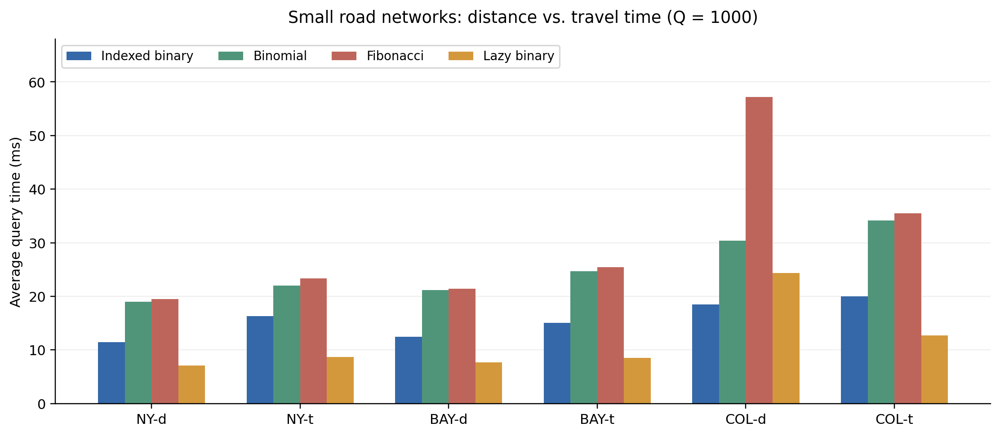
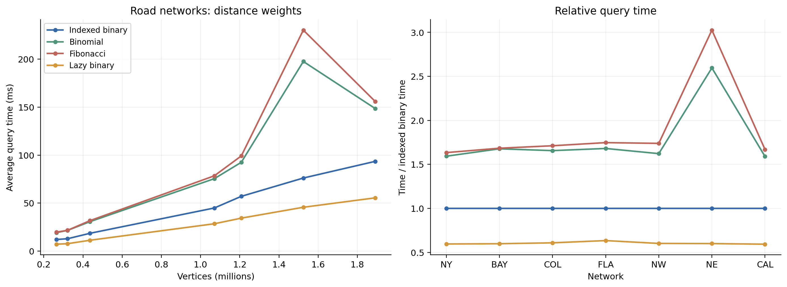
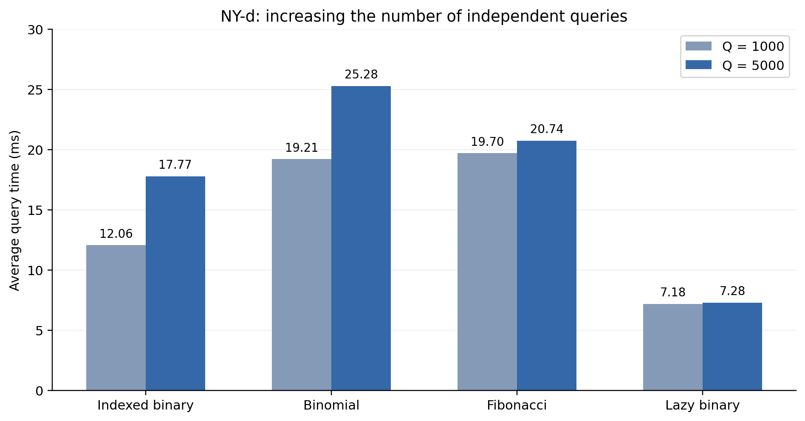
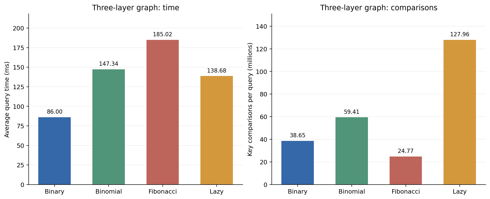

# ADS Project 2: Shortest Path Algorithm with Heaps

## 不同堆实现下的 Dijkstra 算法与性能比较

**课程**：高级数据结构与算法（Advanced Data Structures and Algorithms）

**题目**：8-1 Shortest Path Algorithm with Heaps

**专业年级**：计算机科学与技术，大二

**完成时间**：2026 年 10 月

## 目录

- Chapter 1: Introduction
- Chapter 2: Data Structure and Algorithm Specification
- Chapter 3: Testing Results
- Chapter 4: Analysis and Comments
- 附录 A：小组分工
- 附录 B：源代码

# Chapter 1: Introduction

本项目在非负权有向图上实现 Dijkstra 最短路算法，分别用索引二叉堆、二项堆和斐波那契堆维护优先队列，并加入 lazy 二叉堆作比较。前三种堆支持原地减键，lazy 二叉堆则通过重复插入处理距离更新。

我们主要想回答两个问题：斐波那契堆在复杂度上的优势，能否在实际路网上体现出来；当图更稠密、减键次数更多时，各种堆的表现会怎样变化。实验先使用 DIMACS 美国道路网络，再增加查询数量和人工三层图两组测试。程序用 C++11 编写，四种堆共用同一份 Dijkstra 主循环。

# Chapter 2: Data Structure and Algorithm Specification

## 2.1 三种堆及其操作复杂度

索引二叉堆用数组表示完全二叉树，额外保存顶点到堆下标的映射；二项堆维护按阶数排列的二项树森林；斐波那契堆维护循环双向根链表，将同度树的合并推迟到取出最小元时完成。

以下用 $N$ 表示当前堆内的有效元素数。表中对应本项目实现的操作，**时间复杂度分析见 Chapter 4**。

| 操作 | 索引二叉堆 | 二项堆 | 斐波那契堆 |
| --- | --- | --- | --- |
| 插入 Insert | 最坏 $O(\log N)$ | 均摊 $O(1)$，单次最坏 $O(\log N)$ | $O(1)$ |
| 取出最小元 Extract-Min | 最坏 $O(\log N)$ | 最坏 $O(\log N)$ | 均摊 $O(\log N)$，单次最坏 $O(N)$ |
| 减键 Decrease-Key | 最坏 $O(\log N)$ | 最坏 $O(\log N)$ | 均摊 $O(1)$，单次最坏 $O(N)$ |

我们另外开了一个数组，按顶点编号存下它在堆中的位置：二叉堆存数组下标，二项堆和斐波那契堆存节点指针。减键时查一下数组就能找到对应节点，不需要遍历堆。表中只列 Dijkstra 实际调用的三类操作。

## 2.2 Dijkstra 的流程与 lazy 二叉堆

设图为 $G=(V,E)$，$n=|V|$、$m=|E|$。每次查询给定起点 $s$ 和终点 $t$，流程如下。

1. 将 $s$ 的距离设为 0 并加入堆，其余顶点标为未发现。
2. 取出距离最小的队列记录 $(u,d)$。若它已经失效，则跳过；否则确定 $u$ 的最短距离。
3. 若 $u=t$，返回答案并结束本轮搜索。
4. 扫描 $u$ 的出边。首次发现邻点时插入堆；已有候选距离被严格改善时执行减键。
5. 重复上述过程。若队列耗尽仍未到达 $t$，则返回不可达。

早停必须发生在目标有效出堆时，首次发现目标只说明找到了一条路径，还不能保证最短。

lazy 二叉堆不维护位置映射。每次松弛成功，都直接插入一个新的 `(顶点, 距离)` 记录，旧记录留在堆中。出堆时通过下面的条件过滤：

```cpp
if (done[u] || k != dist[u]) continue;
```

设 lazy 堆中实际存有 $L$ 条记录，按数组扩容的均摊成本计费，则插入和取出最小元均为 $O(\log(L+1))$。它没有原地减键操作，一次逻辑减键对应一次插入。

| 队列实现 | 单次 Dijkstra 的时间上界 | 除图存储外的辅助空间 |
| --- | --- | --- |
| 索引二叉堆 | $O((n+m)\log(n+1))$ | $O(n)$ |
| 二项堆 | $O((n+m)\log(n+1))$ | $O(n)$ |
| 斐波那契堆 | 均摊 $O(m+n\log(n+1))$ | $O(n)$ |
| lazy 二叉堆 | $O(n+(m+1)\log(m+2))$ | $O(n+m)$ |

上表给出包含顶点初始化的单次搜索上界；多次查询时初始化可以复用。对简单图，lazy 的时间上界也可写成常见的 $O((n+m)\log(n+1))$，但其堆内条目数可能达到 $O(m)$。这些结论及早停情况下的计数分析详见 Chapter 4。

## 2.3 实现中比较有用的几个处理

### 统一搜索循环与堆接口适配

`HeapAccess<Heap>` 把堆操作统一成 `insert`、`decrease` 和 `pop`。对前三种堆，`decrease` 调用原地减键；对 lazy 堆，它调用 `push`。这样四种堆都使用 `DijkstraRunner<Heap>`，松弛、早停和状态恢复逻辑完全共用，也不需要运行时虚函数调用。

### 只恢复本轮发现过的顶点

`seen` 表示本轮是否发现过顶点，`done` 表示是否已确定最短距离。首次发现时将顶点加入 `touched`，查询结束只恢复这些顶点的标记，`dist` 是否有效由 `seen` 决定。这里必须包括早停时仍留在堆里的顶点，只清理已经出堆的点会污染下一轮查询。

这种处理将数组标记恢复的工作量限制在本轮发现点数内。堆本身在下一次查询开头清空，并复用已经分配的容量；其清理成本另计。

### CSR 存图与稳定地址的节点池

图使用 `head`、`to`、`w` 三个数组存成 CSR，同一顶点的出边连续排列。输入由 `fread` 整体读入缓冲区后扫描整数，文件解析放在搜索计时之外。

二项堆和斐波那契堆使用 `deque<Node>` 保存节点，查询间复用节点池。它既避免每次插入都单独申请、释放节点，也保证尾部扩容后已有节点的地址有效，父子和兄弟指针不会因容器搬移而失效。

### 同时记录时间与操作次数

除耗时外，程序记录入堆、出堆、成功减键、扫描边、确定顶点和键值比较次数。`decs` 表示已有候选距离被改善的次数，lazy 虽然不原地减键，也使用这一统计口径，同时增加 `pushes`。因此可以区分“算法工作量变多”和“同样工作量做得更慢”。

# Chapter 3: Testing Results

## 3.1 数据选择与实验安排

路网来自 [第 9 届 DIMACS 最短路挑战赛](http://www.diag.uniroma1.it/challenge9/download.shtml)。`d` 表示距离权重，`t` 表示通行时间权重；$m$ 统计文件中的有向弧数，不将一对反向弧合成一条边。

我们按本次测试规模，将 NY、BAY、COL 作为小型网络，将 FLA、NW、NE、CAL 作为中型网络。选用的七个区域如下。

| 区域 | 网络名称 | 顶点数 n | 有向弧数 m | m/n |
| --- | --- | --- | --- | --- |
| NY | New York City | 264,346 | 733,846 | 2.776 |
| BAY | San Francisco Bay Area | 321,270 | 800,172 | 2.491 |
| COL | Colorado | 435,666 | 1,057,066 | 2.426 |
| FLA | Florida | 1,070,376 | 2,712,798 | 2.534 |
| NW | Northwest USA | 1,207,945 | 2,840,208 | 2.351 |
| NE | Northeast USA | 1,524,453 | 3,897,636 | 2.557 |
| CAL | California and Nevada | 1,890,815 | 4,657,742 | 2.463 |

此外还有大型网络 LKS（Great Lakes）、E（Eastern USA）、W（Western USA），以及超大型网络 CTR（Central USA）和 USA（Full USA）。其规模如下。

| 区域 | 网络名称 | 顶点数 n | 有向弧数 m | m/n |
| --- | --- | --- | --- | --- |
| LKS | Great Lakes | 2,758,119 | 6,885,658 | 2.497 |
| E | Eastern USA | 3,598,623 | 8,778,114 | 2.439 |
| W | Western USA | 6,262,104 | 15,248,146 | 2.435 |
| CTR | Central USA | 14,081,816 | 34,292,496 | 2.435 |
| USA | Full USA | 23,947,347 | 58,333,344 | 2.436 |

如果这五个区域都测试 d/t 两种权重、四种堆，每张图各执行 1000 条查询，预计累计运行时间会超过十小时。作为保守的时间预算，以 NE-d 四种堆合计 549.570 秒为参照，按稀疏图的 $n\log n$ 增长粗略外推，再计入两套权重，可得约 11.7 小时。这里借用 NE 这组较慢的测量作预算，估计对运行状态很敏感，不是这些大图的实测时间。

从表中看，这些路网的 $m/n$ 都在 2.35 至 2.78 左右，均有 $m=\Theta(n)$，在稀疏程度上没有实质差异。增加这些区域主要扩大规模，并不能提供稠密图场景；不同区域的拓扑当然仍可能影响搜索过程。考虑运行时间，我们只保留两组路网实验：

1. **小型网络 d/t 对比**：NY、BAY、COL 共六张图，比较权重类型是否明显改变结果。
2. **小型、中型网络 d 图对比**：NY、BAY、COL、FLA、NW、NE、CAL 共七张图，观察规模增长的影响。

两组均为独立点对查询，目标有效出堆就早停。前三张 d 图在两个阶段分别计时，不能把它们当成同一组数据混用。

## 3.2 测试环境、计时与正确性检查

测试使用当前机器：Intel Core i9-13900HX（24 核、32 线程），16 GB 内存，Windows 11 家庭中文版 64 位（系统版本 10.0.26100）。程序为单线程。当前 MinGW-w64 g++ 版本为 15.2.0；复现采用以下编译命令，结果文件本身未嵌入构建参数。

```sh
g++ -O3 -std=c++11 -Wall -Wextra -o code/dijkstra_bench.exe code/dijkstra_bench.cpp
g++ -O3 -std=c++11 -Wall -Wextra -o code/selftest.exe code/selftest.cpp
```

路网每张图使用 1000 条随机点对查询，起终点不同，基础随机种子为 `20261017`，再加区域编号。同一区域 d/t 使用相同种子，在同一标准库环境、顶点数相同的条件下生成相同查询。四种堆读取相同的图和点对顺序。

计时使用 `clock()`，逐次包围 `runner.run(...)` 后累加，再除以 $Q$ 得到平均耗时。图和查询读取、runner 构造及控制台输出不计入；搜索内部的状态恢复、堆清理和操作计数计入。`clock()` 的计时语义取决于平台，本文只比较本机同一计时口径下的数据。

本文实验数据全部取自项目根目录的 `fulltest.res` 和 `customtest.res`。前者的 `small_dt`、`distance_7` 分别对应两组路网实验，后者对应两组自定义实验。日志中相同阶段、相同图和堆的完全重复行只取一次，不作为多轮测量求平均。文件名 `fulltest.res` 不表示做了完整单源性能测试，其中有效结果行的模式均为 `p2p`。

正确性方面，`selftest.cpp` 独立编写了基于 STL `priority_queue` 的 Dijkstra 作参照。对一个固定边界图和 30 组固定种子随机图，四种自实现堆分别枚举所有起终点，与参照的最短距离逐项比较；另检查完整单源搜索的可达点数和距离和。测试包括零权、自环、平行边、并列距离、不可达顶点和起终点相同的情况。同一 runner 连续运行，也检查早停后的状态是否恢复正确。二项堆另有独立的操作测试，覆盖连续插入跨越二的幂边界，以及插入、减键、出堆混合执行；逐步检查根阶数、父子关系、堆序和数组中保存的节点指针。重新编译运行得到：

```text
ALL TESTS PASSED: four heaps match STL priority_queue
```

性能日志中的 `checksum` 累加的是搜索中所有确定顶点的距离，而不是各查询答案。不同堆在并列距离时出堆顺序不同，早停前确定的点也可能略有不同，所以该值不能代替逐项答案对拍。

## 3.3 小型路网的 d/t 对比

下表来自 `fulltest.res` 的 `small_dt` 阶段，单位为 ms/查询。

| 图 | 索引二叉堆 | 二项堆 | 斐波那契堆 | lazy 二叉堆 |
| --- | --- | --- | --- | --- |
| NY-d | 11.429 | 18.979 | 19.464 | 7.114 |
| NY-t | 16.300 | 21.961 | 23.326 | 8.685 |
| BAY-d | 12.470 | 21.148 | 21.430 | 7.688 |
| BAY-t | 15.048 | 24.642 | 25.426 | 8.534 |
| COL-d | 18.477 | 30.398 | 57.167 | 24.310 |
| COL-t | 19.976 | 34.148 | 35.510 | 12.678 |



**图 1**：同一区域 d/t 使用相同查询点对，每张图 1000 次查询。

NY 和 BAY 中，t 图相对 d 图的耗时倍率为 1.11 至 1.43，各堆快慢顺序相同。COL 中二叉堆和二项堆也有小幅增加，但斐波那契堆与 lazy 在 d 图上的时间明显偏高：分别为 57.167 和 24.310 ms，而 t 图为 35.510 和 12.678 ms。

因此不能简单概括为“t 图一定比 d 图慢”。两套权重会改变候选距离与搜索顺序，但都没有让二项堆或斐波那契堆超过索引二叉堆。COL-d 的波动还需要与下一组结果一起看。

## 3.4 小型、中型路网的规模对比

下表来自 `distance_7` 阶段，单位同为 ms/查询。

| 图 | 索引二叉堆 | 二项堆 | 斐波那契堆 | lazy 二叉堆 |
| --- | --- | --- | --- | --- |
| NY-d | 12.060 | 19.208 | 19.702 | 7.181 |
| BAY-d | 12.854 | 21.552 | 21.640 | 7.692 |
| COL-d | 18.519 | 30.671 | 31.695 | 11.272 |
| FLA-d | 44.895 | 75.449 | 78.431 | 28.467 |
| NW-d | 57.037 | 92.512 | 99.157 | 34.318 |
| NE-d | 76.110 | 197.560 | 230.248 | 45.652 |
| CAL-d | 93.466 | 148.587 | 155.992 | 55.446 |



**图 2**：左图比较平均查询耗时，右图以同一张图的索引二叉堆为 1。

在这组实验中，lazy 二叉堆在七张图上都最快，为索引二叉堆耗时的 0.593 至 0.634 倍；二项堆为 1.590 至 2.596 倍，斐波那契堆为 1.634 至 3.025 倍。从 NY 到 CAL，顶点数增加约 7.15 倍，索引二叉堆耗时增加约 7.75 倍，lazy 增加约 7.72 倍，总体随规模上升。

NE 的二项堆和斐波那契堆分别为 197.560 和 230.248 ms，甚至高于规模更大的 CAL；不能据此断言它们随规模单调增长。COL-d 在本阶段的斐波那契堆和 lazy 耗时分别为 31.695 和 11.272 ms，与 d/t 阶段相比，搜索计数相同而时间差别很大。这说明测量存在运行状态波动。日志没有频率、温度或后台负载记录，我们无法确定具体原因，也不对这些结果做删改。

下面用同阶段的操作次数进一步解释主要差距。$R/S$ 表示成功减键次数除以确定顶点数；比较次数为一次查询内全部堆操作的键值比较总数。

| 图 | 确定点/查询 | 减键/查询 | R/S | 二叉堆比较/查询（百万） | 斐波那契堆比较/查询（百万） |
| --- | --- | --- | --- | --- | --- |
| NY-d | 133,830.6 | 19,206.0 | 14.35% | 2.247 | 1.709 |
| BAY-d | 159,999.5 | 13,181.1 | 8.24% | 2.506 | 1.897 |
| COL-d | 223,605.5 | 16,633.6 | 7.44% | 3.576 | 2.702 |
| FLA-d | 515,839.3 | 49,271.9 | 9.55% | 8.636 | 6.538 |
| NW-d | 619,673.4 | 35,824.7 | 5.78% | 10.763 | 8.173 |
| NE-d | 755,261.4 | 70,160.2 | 9.29% | 13.625 | 10.315 |
| CAL-d | 942,452.8 | 77,445.0 | 8.22% | 16.623 | 12.640 |

路网每确定 100 个点，只有约 5.8 至 14.4 次成功减键。以 NY 为例，斐波那契堆每次查询比较约 171 万次，少于二叉堆的 225 万次，耗时却从 12.060 ms 增至 19.702 ms。二项堆也有类似现象。减少比较次数没有抵消根链表遍历、指针修改、节点指针数组的更新及合并等操作的开销。

所以，在本实现和这些路网规模下，二项堆、斐波那契堆落后的主要原因是较大的常数开销。节点池减少了反复分配，但没有消除这些维护成本。缓存局部性也可能影响耗时，不过本实验没有测硬件计数器，不能把它当作已经单独验证的原因。

路网比较仍留下两个问题：增加查询数量，会不会改变单次查询的表现；如果减键变得非常频繁，斐波那契堆是否就能占优。为此，我们增加下面两组实验。

## 3.5 自定义实验一：增加查询次数 Q

查询之间独立执行，不共享最短路状态。如果查询来自相同分布，那么增加 $Q$ 只会增加最外层重复次数，不改变一次 Dijkstra 的复杂度。理论上总时间应大致正比于 $Q$，单次平均耗时应接近稳定。

我们在 NY-d 上将查询数从 1000 增至 5000。生成器使用相同种子和抽样方法，在相同标准库环境下，前 1000 条与标准输入一致。下表以 `distance_7` 的 NY-d 为 1000 次基线，5000 次结果取自 `customtest.res`。

| 堆 | Q=1000 平均 ms | Q=5000 平均 ms | Q=1000 总秒数 | Q=5000 总秒数 | 总时间倍率 | 平均耗时变化 |
| --- | --- | --- | --- | --- | --- | --- |
| 索引二叉堆 | 12.060 | 17.768 | 12.060 | 88.839 | 7.366 | +47.3% |
| 二项堆 | 19.208 | 25.281 | 19.208 | 126.405 | 6.581 | +31.6% |
| 斐波那契堆 | 19.702 | 20.737 | 19.702 | 103.683 | 5.263 | +5.3% |
| lazy 二叉堆 | 7.181 | 7.282 | 7.181 | 36.410 | 5.070 | +1.4% |



**图 3**：Q 从 1000 增到 5000，图中比较单次平均耗时；严格线性时两根柱应等高。

lazy 的单次耗时仅增加 1.4%，斐波那契堆增加 5.3%，总时间分别是基线的 5.07 和 5.26 倍，与预期比较接近。但索引二叉堆和二项堆的单次耗时分别增加 47.3% 和 31.6%，不能说四种堆都严格符合线性。

从计数看，索引二叉堆每次查询平均确定点数由 133830.6 降至 132277.8，扫描边数由 381146.4 降至 376586.2，平均工作量反而略有下降。因此较大的时间增幅不能用搜索范围扩大来解释。本实验在工作量层面支持“Q 只增加外层重复次数”，lazy 和斐波那契堆的时间结果也接近这一预期；其余两种堆存在明显测量波动，现有单轮数据不足以进一步归因。

## 3.6 自定义实验二：高减键三层图

### 图的构造

图分成源点 $s$、中间层 $u_1,\ldots,u_k$ 和目标层 $v_1,\ldots,v_r$。只设置两类有向边：源点连向每个中间点，每个中间点连向所有目标点，目标点没有出边。

令 $A=r+1$、$B=k+1$，设置

$$
w(s,u_i)=i,\qquad w(u_i,v_j)=B+(k-i)A+j-i.
$$

所有边权都为正，最小的中间层到目标层边权为 2。由于 $d(u_i)=i\le k$，而任何目标的候选距离至少为 $B+1=k+2$，全部中间点都会先于目标点确定。通过 $u_i$ 得到的目标候选距离为

$$
d_i(v_j)=B+(k-i)A+j.
$$

每处理下一个中间点，所有目标的候选距离都严格下降 $A$。第一次处理 $u_1$ 时插入 $r$ 个目标，此后每轮均产生 $r$ 次减键，故每次查询的减键数为 $(k-1)r$。同一个中间点的出边按 $j=r,r-1,\ldots,1$ 扫描，让本轮后更新的目标拥有更小距离，增加上浮压力；这仍不保证每次上浮都走满堆高。

图有 $n=1+k+r$ 个点、$m=k+kr$ 条边。当 $k=r$ 同时增大时，$m=\Theta(n^2)$，是一族稠密图。默认 $k=r=3000$，于是

$$
n=6001,\qquad m=9\,003\,000,\qquad R=(k-1)r=8\,997\,000.
$$

1000 条查询都从 $s$ 出发，目标按编号循环选择，仍逐条独立运行。目标早停前一定已经扫描全部中间层出边，因此每次查询均扫描 9,003,000 条边。最终 $d(v_j)=B+j$，这也给出了构造的解析答案。

### 实测结果

下表来自 `customtest.res`，计数均已除以查询数 1000。

| 堆 | 平均 ms | 相对二叉堆 | 入堆/查询 | 出堆/查询 | 减键/查询 | 比较/查询（百万） |
| --- | --- | --- | --- | --- | --- | --- |
| 索引二叉堆 | 85.995 | 1.000 | 6,001 | 3,501.5 | 8,997,000 | 38.648 |
| 二项堆 | 147.335 | 1.713 | 6,001 | 3,501.5 | 8,997,000 | 59.408 |
| 斐波那契堆 | 185.024 | 2.152 | 6,001 | 3,501.5 | 8,997,000 | 24.771 |
| lazy 二叉堆 | 138.679 | 1.613 | 9,003,001 | 3,501.5 | 8,997,000 | 127.956 |



**图 4**：左图为平均查询时间，右图为平均键值比较次数，两者的排序并不相同。

这组图中，索引二叉堆仍最快，为 85.995 ms；lazy 为它的 1.613 倍，二项堆为 1.713 倍，斐波那契堆为 2.152 倍。斐波那契堆约有 2477 万次比较，少于二叉堆的 3865 万次，但维护结构的成本仍使它最慢。因此，高减键频率在本组参数下还不足以让斐波那契堆获得时间优势。

lazy 的情况与路网明显不同：每次查询入堆 9,003,001 次，而其他堆只有 6001 次。在全部中间点处理完、目标尚未出堆时，lazy 堆内已经积累 9,000,000 条目标记录。虽然顶点只有六千多个，实际维护的队列却很大。

本构造中，旧记录的距离都大于全部最终目标距离，查询会在弹出这些旧记录前早停。因此四种堆的平均出堆数相同，均为 3501.5；lazy 变慢不能归因于本轮大量无效出堆，而主要对应重复插入、大队列上的调整及存储开销。这个细节也说明，只看顶点数或出堆次数会漏掉相当一部分工作量。

# Chapter 4: Analysis and Comments

## 4.1 三种堆的理论复杂度

本节先分析堆操作，再将操作次数代入 Dijkstra。堆大小记为 $N$，顶点数记为 $n$，两者不混用。减键时通过数组直接取得节点下标或指针；初始化和清空另外计算。数组扩容按通常的均摊方式计费，本项目的索引数组和节点池在构造时预分配。

### 4.1.1 索引二叉堆

完全二叉树有 $\lfloor\log_2 N\rfloor$ 层边。插入把新元素放在末尾，减键通过 `pos[v]` 找到元素，二者都只可能沿父链上浮。每移动一层，比较和更新位置的次数为常数，因此最坏为 $O(\log(N+1))$。

取出最小元后，将末尾元素移到根。每次选择较小的孩子比较并下沉，最多走到叶子，每层仍只有常数次操作，所以也是 $O(\log(N+1))$。根到叶子的路径长度给出了这些操作的上界，但不是每次实际移动的距离。

### 4.1.2 二项堆

二项树 $B_0$ 有一个节点，两棵 $B_{j-1}$ 合成 $B_j$。由归纳可得 $B_j$ 有 $2^j$ 个节点、高度为 $j$。二项堆每阶最多一棵树，因此最高阶不超过 $\lfloor\log_2 N\rfloor$，根数至多 $1+\lfloor\log_2 N\rfloor$。

合并时，先按阶数归并两条根链表，再连接同阶树。每次连接让根数减少一，产生的新树只向更高阶推进，总扫描与连接次数均为 $O(\log(N+1))$。

插入从一个零阶树开始，只与根链表开头同阶的树合并。每合并一次，阶数增加一；遇到不同阶的根就将新树接回链表，不再扫描后面的树。这相当于二进制加一时的连续进位，单次最多合并 $O(\log(N+1))$ 次。

设一次插入合并了 $c$ 次，根数的变化为 $1-c$。取势能 $\Psi(H)=C\cdot T(H)$，其中 $T(H)$ 为根数，$C$ 为足够大的常数。实际成本为 $O(c+1)$，势能变化为 $C(1-c)$，所以插入的均摊成本为 $O(1)$。减键不改变根数；取出最小元最多增加 $O(\log(N+1))$ 个根，因此在同一势能下仍为均摊 $O(\log(N+1))$，这套分析也适用于三类操作混合执行。

取出最小元先扫描根表；最小根最多有 $O(\log N)$ 个孩子，逆转孩子链表后再与剩余根表合并，三个步骤各为 $O(\log(N+1))$。减键沿父链交换键值和顶点编号，并同步更新数组中对应的两个节点指针，树高为 $O(\log N)$，故最坏也为 $O(\log(N+1))$。

### 4.1.3 斐波那契堆的最大度数

斐波那契堆允许一个非根节点在成为孩子后失去一个孩子；再次失去孩子时，该节点会被切到根表。这个规则约束的是节点度数与子树大小的关系，并不保证树高为对数。

设节点 $x$ 当前有 $d$ 个孩子，按它们最近一次连接到 $x$ 的时间排序为 $y_1,\ldots,y_d$。连接 $y_i$ 时，$x$ 至少已有前面的 $i-1$ 个孩子；合并只发生在同度根之间，所以当时 $y_i$ 的度数至少为 $i-1$。之后它若失去两个孩子就会被切走，因此只要它仍是 $x$ 的孩子，就有

$$
\deg(y_1)\ge 0,\qquad \deg(y_i)\ge i-2\quad(i\ge 2).
$$

定义 $F_0=0,F_1=1$。对节点所在子树的大小作强归纳：叶子的子树大小为 $1=F_2$；其余节点的孩子子树更小，可以使用归纳假设。$d=1$ 时子树至少有两个节点。$d\ge2$ 时，利用上面的度数下界，有

$$
\begin{aligned}
\operatorname{size}(x)
&=1+\sum_{i=1}^{d}\operatorname{size}(y_i)\\
&\ge 2+\sum_{i=2}^{d}F_i
=F_{d+2}.
\end{aligned}
$$

最后一步使用 $\sum_{i=0}^{d}F_i=F_{d+2}-1$。令 $\varphi=(1+\sqrt5)/2$，由递推式和 $\varphi^2=\varphi+1$ 可归纳得 $F_{d+2}\ge\varphi^d$。于是

$$
N\ge\operatorname{size}(x)\ge\varphi^d
\quad\Longrightarrow\quad d\le\log_{\varphi}N.
$$

因此最大度数 $D(N)=O(\log(N+1))$。接下来的取出最小元分析依赖这个结论。

### 4.1.4 势能法分析

设 $T(H)$ 为根的数量，$M(H)$ 为有标记的非根节点数量，取势能

$$
\Phi(H)=C\bigl(T(H)+2M(H)\bigr),\qquad C>0.
$$

$C$ 取足够大的常数，用于覆盖每次链表操作和根表扫描的常数成本。势能非负，空堆势能为 0。对一次操作，均摊成本为

$$
\widehat c_i=c_i+\Phi(H_i)-\Phi(H_{i-1}).
$$

整个操作序列的实际成本等于均摊成本之和减去最终势能，因此不超过均摊成本之和。这里 $M$ 只统计非根节点；一个节点升到根表后，即使代码中保留了其 `mark` 位，也不再计入 $M$，再次连接为孩子时会清除标记。

**插入。** 将单节点接到根表并更新最小指针，实际成本为 $O(1)$，根数增加 1，标记数不变。故均摊成本也是 $O(1)$。

**减键。** 若不违反父子堆序，直接更新键值和最小指针，成本为 $O(1)$。若发生 $c\ge1$ 次剪切，实际成本为 $O(c+1)$，根数增加 $c$。除第一次剪切外，其余被级联剪切的非根节点原先都带标记，至少清除 $c-1$ 个计入势能的标记；级联结束最多新增一个标记。因此

$$
\Delta M\le 1-(c-1)=2-c,
\qquad
\Delta\Phi\le C\bigl(c+2(2-c)\bigr)=C(4-c).
$$

选择足够大的 $C$ 后，势能下降支付了与 $c$ 成正比的成本，所以均摊为 $O(1)$。单次操作仍可能发生很长的级联，不能将这个结论写成最坏 $O(1)$。

**取出最小元。** 设操作前有 $T$ 个根，最小根有 $d\le D(N)$ 个孩子。提升孩子并删去最小根后，待处理根数为 $R_0=T-1+d$。归并通过度数表连接同度树，连接次数不超过 $R_0$；最终每度至多一个根，故根数 $T'\le D(N)+1$。

本实现先保存根快照，再做归并；`used` 也可能记录重复度数，但每个待处理根至多追加一次，所以这些额外扫描仍是 $O(R_0)$。连同度数表处理，实际成本可界为

$$
c_i\le aT+bD(N)+b
$$

其中 $a,b$ 为常数。提升孩子和连接树不会增加计入势能的标记数，因此

$$
\Delta\Phi\le C(T'-T)\le C(D(N)+1-T).
$$

取 $C\ge a$ 后，关于 $T$ 的项被抵消，得到均摊成本 $O(D(N)+1)=O(\log(N+1))$。单次可能遍历线性数量的根，故最坏仍为 $O(N)$。

## 4.2 Dijkstra 的正确性与复杂度

### 4.2.1 为什么有效出堆后可以确定距离

设已确定集合为 $S$，下一个有效出堆点为 $u$。若存在一条长度严格小于 $d[u]$ 的最短路径，沿这条路径取第一个不在 $S$ 中的点 $y$，其前驱已经在 $S$ 中并完成出边扫描。因此 $d[y]$ 不大于该最短路径到 $y$ 的前缀长度。边权非负，前缀长度不大于整条路径长度，所以 $d[y]<d[u]$，与 $u$ 是最小候选矛盾。

源点最先确定，归纳即可证明所有有效出堆点的距离正确。lazy 中尚未确定的已发现点始终有一条与当前 `dist` 相等的记录在堆内，过期记录过滤不会删除这条有效候选，因此同一证明成立。目标首次有效出堆即可返回；若队列耗尽，仍未发现的目标不可达。

### 4.2.2 支持原地减键的三种堆

对一次实际搜索，记发现点数为 $I$、有效出堆数为 $X$、扫描弧数为 $m_s$、成功改善已有候选的次数为 $R$。非负边权保证已确定点不再更新，所以

$$
X\le I\le n,\qquad m_s\le m,\qquad R\le m_s.
$$

每个发现点插入一次，每个确定点取出一次，每次已有候选改善减键一次。若该轮最大有效堆大小为 $H\le n$，二叉堆的搜索与本轮状态恢复成本为

$$
O\bigl(1+I+m_s+(I+X+R)\log(H+1)\bigr).
$$

二项堆插入均摊为常数，因此相应的均摊成本为

$$
O\bigl(1+I+m_s+(X+R)\log(H+1)\bigr).
$$

两者加上一次性 $O(n)$ 的 runner 初始化，时间上界均可写成

$$
O\bigl((n+m)\log(n+1)\bigr).
$$

斐波那契堆插入和减键均摊 $O(1)$、取出最小元均摊 $O(\log(n+1))$，故搜索的均摊成本为

$$
O\bigl(1+I+m_s+R+X\log(n+1)\bigr),
$$

加上初始化后为 $O(m+n\log(n+1))$。早停时终态势能非负，不影响这一序列成本上界。堆的 `clear` 在下一轮开始执行，下标和节点指针数组的清理按所涉及的发现点数计费，累计可归入各轮的 $O(I)$；末次查询后尚未进行的清理不增加已记录的计时。

### 4.2.3 lazy 二叉堆

lazy 每次首次发现或成功减键都插入，所以插入数为 $P=I+R$。源点以外，每次首次发现或改善都由一条已扫描弧触发，故 $P\le m_s+1$。出堆数不超过插入数，最大条目数也不超过 $P$。因此一次搜索成本为

$$
O\bigl(1+I+m_s+P\log(P+1)\bigr).
$$

包含初始化的上界为 $O(n+(m+1)\log(m+2))$，辅助空间为 $O(n+m)$。简单图有 $m=O(n^2)$，从而 $\log(m+2)=O(\log(n+1))$；若允许任意多重边，则应保留关于 $m$ 的对数。

### 4.2.4 多次查询和图的稀疏程度

各条查询独立运行，设单次时间上界为 $f(n,m)$，则 $Q$ 条查询的搜索时间为 $O(Qf(n,m))$，再加一次性初始化。若计入图读取和存储构造，还要加 $O(n+m)$。Q 不会改变堆操作本身的复杂度，但“大 O 多乘一个 Q”也不保证一次有波动的测量恰好放大 Q 倍。

在路网这样的稀疏图中，$m=\Theta(n)$，二叉堆、二项堆和斐波那契堆的单次最坏或均摊上界都落在 $O(n\log n)$。因此，斐波那契堆在这类图上没有渐近阶数优势。

当 $m=\Theta(n^2)$ 时，二叉堆和二项堆的一般上界为 $O(n^2\log n)$，斐波那契堆为 $O(n^2)$。三层图还进一步保证 $R=\Theta(m)$，减键次数不会因为大量松弛失败而变少。不过这些都是上界，不能反过来断言二叉堆在这族图上的每次减键都需要 $\Theta(\log n)$，或仅凭一次规模的实验判定其渐近增长率。

## 4.3 为什么理论上更好的堆没有更快

### log n 的数值很小，实际堆通常还更小

七张路网的 $\log_2 n$ 约为 18.0 至 20.9，三层图只有约 12.6。理论上从 $O(\log n)$ 降到均摊 $O(1)$，在当前规模下省下的是有限的比较与移动，并不意味着可以忽略另一种结构的维护开销。

而且二叉堆中只保存搜索前沿的候选点，并非图上全部顶点，真正的调整上界是 $O(\log(H+1))$，$H$ 是当时的堆大小。插入和减键一旦满足父子堆序就会停止，取出最小元也可能提前结束下沉，所以许多操作根本不会触及最坏上界。

代码的上浮、下沉采用暂存待移动元素、逐层填空的方式，避免每层都交换两个完整条目。索引二叉堆需要维护 `pos`，lazy 则省掉它；在路网成功减键较少时，lazy 多出的条目还不算多，这有助于解释它在路网上更快的结果。

计数可以帮助判断，但也有边界。例如 NY-d 的二叉堆把全部键值比较次数除以出堆次数得到约 16.79；这个分子还包含插入和减键的比较，不能称为“每次出堆只比较 16.79 次”，更不能由此推算精确的平均上浮层数。本次日志未记录峰值堆大小和移动层数，这里只给出由代码停止条件能确定的解释。

### 较大的维护常数可以抵消比较次数优势

二项堆取最小元需要扫描根表、逆转孩子链表并合并；减键还要交换顶点归属并更新数组中保存的节点指针。斐波那契堆虽然减键均摊为常数，仍需要判断父子关系、维护标记和多组指针，取最小元则要收集根、按度归并和重建根表。这些操作不全体现在键值比较次数中。

三层图中，斐波那契堆的比较数约为二叉堆的 64.1%，耗时却约为 2.152 倍，是“比较更少但整体更慢”的直接例子。路网上也出现相同现象，因此较大的结构维护常数是解释结果的主要因素。统计计数本身也在计时区间内，本文比较的是带相同统计口径的实现。

我们的结论限于本项目实现与测试规模：普通路网上 lazy 二叉堆总体最快；高减键三层图中，索引二叉堆更合适。斐波那契堆的均摊复杂度证明仍然成立，只是在这些参数下没有转化为运行时间优势。要研究更大规模下是否出现交叉，需要改变构造规模并做重复测量，现有结果不能给出交叉点。

# 附录 A：小组分工

| 姓名 | 学号 | 主要工作 | 贡献比例 |
| --- | --- | --- | --- |
| 【成员 1】 | 【学号 1】 | 四种堆与统一 Dijkstra 搜索实现，三层图构造 | 40% |
| 【成员 2】 | 【学号 2】 | 路网及查询准备，性能测试，STL 参照对拍 | 30% |
| 【成员 3】 | 【学号 3】 | 复杂度分析，实验数据整理与绘图，报告撰写 | 30% |

# 附录 B：源代码

以下列出堆、搜索和测试程序，以及两个输入生成器的完整源码。文件相对路径以项目根目录为基准。


## B.1 堆的实现（`code/heaps.h`）

```cpp
#ifndef HEAPS_H
#define HEAPS_H

#include <deque>
#include <vector>
#include <utility>

using namespace std;
typedef long long Key;
const Key KEY_INF = 1LL << 60;

// 二叉堆的数组中只保存顶点编号，距离由 key 按编号索引
// pos 是反向映射，任何元素移动都要更新对应位置
// 同一顶点在当前堆中最多出现一次
// 减键从 pos 直接定位，然后沿父链上浮
// 弹出最小值后使用末尾元素补根，再沿较小孩子下沉
// 数组位置 i 的父亲为 (i - 1) / 2
// 左右孩子分别位于 2 * i + 1 和 2 * i + 2
// 清空只重置 touched 中的 pos，不必重置所有候选距离
// insert 和 decreaseKey 的调用者应保证顶点成员状态正确
// 所有键值比较统一经过 lessKey，以便与其他堆比较工作量
struct BinaryHeap {
	BinaryHeap(int n = 0) {
		init(n);
	}

	// 按顶点编号分配索引空间，所有顶点初始都不在堆中
	void init(int n) {
		key.assign(n + 1, 0); // 有效性由位置索引决定，键值无需统一设为无穷
		pos.assign(n + 1, -1); // 顶点编号从一开始，负值表示尚未入堆
		heap.clear();
		touched.clear();
		heap.reserve(n + 1);
		touched.reserve(n + 1);
		cmp_cnt = 0;
	}

	// 只恢复本轮涉及的索引并复用已有容量，避免反复分配节点
	void clear() {
		for (size_t i = 0; i < touched.size(); i ++ ) { // 清理只遍历本轮涉及的顶点，不扫描整张路网
			pos[touched[i]] = -1;
		}
		touched.clear();
		heap.clear();
	}

	// 由当前有效堆元素判断搜索是否结束
	bool empty() const {
		return heap.empty();
	}

	// 返回当前堆内元素个数
	int size() const {
		return (int)heap.size();
	}

	// 通过顶点索引判断是否已经入堆，避免扫描整个堆
	bool contains(int v) const {
		return pos[v] >= 0;
	}

	// 读取顶点当前候选距离，供松弛操作判断是否需要减键
	Key keyOf(int v) const {
		return key[v];
	}

	// 比较次数累积到堆对象中，查询前后作差即可获得单轮统计
	long long cmps() const {
		return cmp_cnt;
	}

	// 建立新候选距离并维护顶点到堆位置的映射
	void insert(int v, Key k) {
		key[v] = k;
		pos[v] = (int)heap.size();
		heap.push_back(v);
		touched.push_back(v);
		siftUp((int)heap.size() - 1);
	}

	// 只允许键值减小，恢复堆序时同步维护节点编号映射
	void decreaseKey(int v, Key k) {
		key[v] = k;
		siftUp(pos[v]);
	}

	// 弹出最小候选距离，剩余结构重新满足最小堆性质
	int extractMin() {
		int top = heap[0];
		int last = heap.back();
		heap.pop_back();
		pos[top] = -1; // 弹出的顶点不再属于当前堆
		if (!heap.empty()) { // 堆非空时才需要把尾元素移动到根位置
			heap[0] = last;
			pos[last] = 0;
			siftDown(0);
		}
		return top;
	}

	// 暂存待调整元素，将祖先逐层下移以减少交换次数
	void siftUp(int i) {
		int v = heap[i]; // 保存该节点对应的图顶点编号
		Key k = key[v];
		while (i > 0) { // 只有非根节点才可能继续向父节点上浮
			int p = (i - 1) >> 1;
			int pv = heap[p];
			if (!lessKey(k, key[pv])) { // 与父节点满足最小堆序时停止移动
				break;
			} else {
				heap[i] = pv;
				pos[pv] = i; // 被下移的祖先也必须更新位置
				i = p;
			}
		}
		heap[i] = v;
		pos[v] = i; // 数组位置变化后同步反向索引
	}

	// 每次选择较小的孩子上移，直到暂存元素可以放入空位
	void siftDown(int i) {
		int n = (int)heap.size();
		int v = heap[i]; // 保存该节点对应的图顶点编号
		Key k = key[v];
		for (;;) {
			int c = 2 * i + 1;
			if (c >= n) { // 当前空位没有孩子，暂存元素可直接落位
				break;
			} else {
				if (c + 1 < n && lessKey(key[heap[c + 1]], key[heap[c]])) { // 右孩子存在且更小时，优先选择右孩子
					c ++ ;
				}
				if (!lessKey(key[heap[c]], k)) { // 孩子中的最小键值已不能继续改善当前层
					break;
				} else {
					heap[i] = heap[c];
					pos[heap[i]] = i;
					i = c;
				}
			}
		}
		heap[i] = v;
		pos[v] = i; // 数组位置变化后同步反向索引
	}

	// 所有键值比较统一计数，便于解释不同堆的实际工作量
	bool lessKey(Key a, Key b) {
		cmp_cnt ++ ; // 只统计键值比较，不包含循环条件判断
		return a < b;
	}

	vector<Key> key; // 保存节点键值或按顶点索引的候选距离
	vector<int> pos; // 顶点到数组位置的反向索引，不在堆中时使用无效值
	vector<int> heap; // 数组位置表示完全二叉树中的位置
	vector<int> touched; // 记录本轮涉及的顶点，使清理只访问实际使用的索引
	long long cmp_cnt = 0; // 累计键值比较次数，清空堆时保留以便作差
};

// =============================================================================
//  2. 二项堆（严格二项树森林，对度数按位合并）
// =============================================================================
// 二项堆由不同阶数的二项树组成，根链表按阶数排列
// 一棵阶数为 k 的二项树包含二的 k 次方个节点
// 同阶树合并时以较小根作为新父节点
// 插入只从零阶开始连续进位，遇到不同阶的根就停止
// 根表遇到连续三个同阶根时要避免破坏阶数顺序
// 减键沿父链交换键值和顶点编号，因此节点映射也要交换
// 弹出最小根需要先扫描所有根，不依赖缓存最小指针
// 摘下最小根后逆转孩子链表，再与剩余根表归并
// 节点池复用已分配空间，clear 不逐个释放节点
// 该实现只用于非负权 Dijkstra，不提供删除任意键的接口
struct BinomialHeap {
	struct Node {
		Key key; // 保存节点键值或按顶点索引的候选距离
		int v; // 保存该节点对应的图顶点编号
		int degree; // 孩子数量，也是归并时使用的树阶数
		Node *parent; // 父指针用于减键上浮或级联切断
		Node *child; // 孩子链表入口，弹出父节点时需要提升孩子
		Node *sibling; // 兄弟指针将同层节点连接成链表
	};

	BinomialHeap(int n = 0) {
		init(n);
	}

	// 按顶点编号分配索引空间，所有顶点初始都不在堆中
	void init(int n) {
		pool.resize(n + 1);
		handle.assign(n + 1, nullptr);
		in.assign(n + 1, 0);
		touched.clear();
		touched.reserve(n + 1);
		head = nullptr;
		nfree = 0; // 保留节点池容量，下一轮从首个节点复用
		total_size = 0;
		cmp_cnt = 0;
	}

	// 只恢复本轮涉及的索引并复用已有容量，避免反复分配节点
	void clear() {
		for (size_t i = 0; i < touched.size(); i ++ ) { // 清理只遍历本轮涉及的顶点，不扫描整张路网
			int v = touched[i]; // 保存该节点对应的图顶点编号
			handle[v] = nullptr;
			in[v] = 0;
		}
		touched.clear();
		head = nullptr;
		nfree = 0; // 保留节点池容量，下一轮从首个节点复用
		total_size = 0;
	}

	// 由当前有效堆元素判断搜索是否结束
	bool empty() const {
		return head == nullptr;
	}

	// 通过顶点索引判断是否已经入堆，避免扫描整个堆
	bool contains(int v) const {
		return in[v] != 0;
	}

	// 读取顶点当前候选距离，供松弛操作判断是否需要减键
	Key keyOf(int v) const {
		return handle[v]->key;
	}

	// 比较次数累积到堆对象中，查询前后作差即可获得单轮统计
	long long cmps() const {
		return cmp_cnt;
	}

	// 建立新候选距离并维护顶点到堆位置的映射
	void insert(int v, Key k) {
		Node *x = alloc();
		x->key = k;
		x->v = v;
		x->degree = 0;
		x->parent = nullptr; // 移到根链表后不再有父节点
		x->child = nullptr; // 更新孩子入口，保证后续能遍历全部孩子
		x->sibling = nullptr; // 维护同层链表，便于根表归并或孩子提升
		handle[v] = x;
		in[v] = 1;
		touched.push_back(v);
		// 新节点从零阶开始进位，后续不同阶的根无需扫描
		while (head && head->degree == x->degree) {
			Node *y = head;
			head = y->sibling;
			if (lessKey(y->key, x->key)) {
				swap(x, y);
			}
			link(y, x);
		}
		x->sibling = head;
		head = x;
		total_size ++ ; // 插入增加有效元素数，节点池容量不代表堆大小
	}

	// 只允许键值减小，恢复堆序时同步维护节点编号映射
	void decreaseKey(int v, Key k) {
		Node *x = handle[v];
		x->key = k;
		while (x->parent && lessKey(x->key, x->parent->key)) {
			Node *p = x->parent;
			swap(x->key, p->key); // 交换键值和顶点归属后，必须保持索引映射一致
			swap(x->v, p->v); // 交换键值和顶点归属后，必须保持索引映射一致
			handle[x->v] = x;
			handle[p->v] = p;
			x = p;
		}
	}

	// 弹出最小候选距离，剩余结构重新满足最小堆性质
	int extractMin() {
		Node *prev = nullptr;
		Node *minNd = nullptr;
		Node *prevMin = nullptr;
		for (Node *x = head; x; prev = x, x = x->sibling) {
			if (!minNd || lessKey(x->key, minNd->key)) {
				minNd = x;
				prevMin = prev;
			}
		}

		if (prevMin) {
			prevMin->sibling = minNd->sibling; // 维护同层链表，便于根表归并或孩子提升
		} else {
			head = minNd->sibling;
		}

		int v = minNd->v; // 保存该节点对应的图顶点编号
		handle[v] = nullptr;
		in[v] = 0;
		total_size -- ; // 弹出只减少有效元素数，节点空间留待复用

		Node *ch = minNd->child;
		Node *rev = nullptr;
		while (ch) {
			Node *nxt = ch->sibling;
			ch->sibling = rev; // 维护同层链表，便于根表归并或孩子提升
			ch->parent = nullptr; // 更新所属父节点，供减键时沿父链处理
			rev = ch;
			ch = nxt;
		}

		head = unionLists(head, rev);
		return v;
	}

	// 复用稳定地址的节点池，避免每次插入都申请独立内存
	Node* alloc() {
		if ((size_t)nfree >= pool.size()) { // 只有已分配容量不足时才扩展节点池
			pool.emplace_back();
		}
		return &pool[(size_t)nfree ++ ]; // 返回池内稳定地址，不能使用会移动节点的数组
	}

	static Node* mergeRoots(Node *a, Node *b) {
		Node dummy;
		dummy.sibling = nullptr;
		Node *tail = &dummy;
		while (a && b) {
			if (a->degree <= b->degree) {
				tail->sibling = a; // 维护同层链表，便于根表归并或孩子提升
				a = a->sibling;
			} else {
				tail->sibling = b; // 维护同层链表，便于根表归并或孩子提升
				b = b->sibling;
			}
			tail = tail->sibling;
		}
		tail->sibling = a ? a : b; // 维护同层链表，便于根表归并或孩子提升
		return dummy.sibling;
	}

	// 将较大根挂到较小根下，两棵同阶树合并后阶数增加一
	void link(Node *y, Node *z) {
		y->parent = z; // 合并后较小根成为父节点
		y->sibling = z->child; // 维护同层链表，便于根表归并或孩子提升
		z->child = y; // 更新孩子入口，保证后续能遍历全部孩子
		z->degree ++ ; // 挂接一个孩子后，父节点度数增加一
	}

	// 按阶数合并根链表，并处理连续出现多个同阶根的情况
	Node* unionLists(Node *a, Node *b) {
		Node *h = mergeRoots(a, b);
		if (!h) {
			return nullptr;
		} else {
			Node *prev = nullptr;
			Node *x = h;
			Node *nx = x->sibling;
			while (nx) {
				if (x->degree != nx->degree || (nx->sibling && nx->sibling->degree == x->degree)) {
					prev = x;
					x = nx;
				} else if (!lessKey(nx->key, x->key)) {
					x->sibling = nx->sibling; // 维护同层链表，便于根表归并或孩子提升
					link(nx, x);
				} else {
					if (prev) {
						prev->sibling = nx; // 维护同层链表，便于根表归并或孩子提升
					} else {
						h = nx;
					}
					link(x, nx);
					x = nx;
				}
				nx = x->sibling;
			}
			return h;
		}
	}

	// 所有键值比较统一计数，便于解释不同堆的实际工作量
	bool lessKey(Key a, Key b) {
		cmp_cnt ++ ; // 只统计键值比较，不包含循环条件判断
		return a < b;
	}

	deque<Node> pool; // 双端队列扩容后已有节点地址保持有效
	vector<Node*> handle; // 按顶点编号保存节点指针，减键时直接查数组
	vector<char> in;
	vector<int> touched; // 记录本轮涉及的顶点，使清理只访问实际使用的索引
	Node *head = nullptr; // 根链表入口，根节点按度数有序连接
	int nfree = 0; // 节点池下一可复用位置，清空后从头使用
	int total_size = 0; // 有效元素总数，不包含节点池中的闲置空间
	long long cmp_cnt = 0; // 累计键值比较次数，清空堆时保留以便作差
};

// =============================================================================
//  3. 斐波那契堆（双向循环链表 + 级联剪枝 + 延迟合并）
// =============================================================================
// 根节点和同胞节点均以循环双链表连接
// 最小根指针避免每次取最小值都扫描根链表
// 插入只挂接新根，树的归并延迟到弹出最小值时
// 度数归并表 A 的下标代表根节点拥有的孩子数
// 归并前先收集根节点，防止修改链表时丢失遍历位置
// 非根节点首次失去孩子时设置 mark
// 已标记节点再次失去孩子时被切到根链表
// 级联切断沿父链继续，遇到未标记节点或根时停止
// 从父节点切下的根重新清除 mark，保持势能分析的不变量
// 节点池使用稳定地址，父子与兄弟指针在扩容后继续有效
struct FibonacciHeap {
	struct Node {
		Key key; // 保存节点键值或按顶点索引的候选距离
		int v; // 保存该节点对应的图顶点编号
		int degree; // 孩子数量，也是归并时使用的树阶数
		bool mark; // 记录非根节点是否已经失去过一个孩子
		Node *parent; // 父指针用于减键上浮或级联切断
		Node *child; // 孩子链表入口，弹出父节点时需要提升孩子
		Node *left; // 循环双链表的前驱，用于常数时间摘除节点
		Node *right; // 循环双链表的后继，用于常数时间拼接节点
	};

	FibonacciHeap(int n = 0) {
		init(n);
	}

	// 按顶点编号分配索引空间，所有顶点初始都不在堆中
	void init(int n) {
		pool.resize(n + 1);
		handle.assign(n + 1, nullptr);
		in.assign(n + 1, 0);
		A.assign(64, nullptr);
		roots.reserve(64);
		used.reserve(64);
		touched.clear();
		touched.reserve(n + 1);
		min_node = nullptr;
		nfree = 0; // 保留节点池容量，下一轮从首个节点复用
		total_size = 0;
		cmp_cnt = 0;
	}

	// 只恢复本轮涉及的索引并复用已有容量，避免反复分配节点
	void clear() {
		for (size_t i = 0; i < touched.size(); i ++ ) { // 清理只遍历本轮涉及的顶点，不扫描整张路网
			int v = touched[i]; // 保存该节点对应的图顶点编号
			handle[v] = nullptr;
			in[v] = 0;
		}
		touched.clear();
		min_node = nullptr;
		nfree = 0; // 保留节点池容量，下一轮从首个节点复用
		total_size = 0;
		used.clear();
	}

	// 由当前有效堆元素判断搜索是否结束
	bool empty() const {
		return min_node == nullptr;
	}

	// 通过顶点索引判断是否已经入堆，避免扫描整个堆
	bool contains(int v) const {
		return in[v] != 0;
	}

	// 读取顶点当前候选距离，供松弛操作判断是否需要减键
	Key keyOf(int v) const {
		return handle[v]->key;
	}

	// 比较次数累积到堆对象中，查询前后作差即可获得单轮统计
	long long cmps() const {
		return cmp_cnt;
	}

	// 建立新候选距离并维护顶点到堆位置的映射
	void insert(int v, Key k) {
		Node *x = alloc();
		x->key = k;
		x->v = v;
		x->degree = 0;
		x->mark = false; // 成为根或新孩子时重新开始记录失子状态
		x->parent = nullptr; // 移到根链表后不再有父节点
		x->child = nullptr; // 更新孩子入口，保证后续能遍历全部孩子
		x->left = x; // 维护双向链接，使后续可以常数时间摘链
		x->right = x; // 维护后继关系，保留循环链表的连接不变量

		if (!min_node) { // 空堆或出现更小根时更新最小节点缓存
			min_node = x;
		} else {
			x->left = min_node; // 维护双向链接，使后续可以常数时间摘链
			x->right = min_node->right; // 维护后继关系，保留循环链表的连接不变量
			min_node->right->left = x;
			min_node->right = x; // 维护后继关系，保留循环链表的连接不变量
			if (lessKey(k, min_node->key)) {
				min_node = x;
			}
		}
		handle[v] = x;
		in[v] = 1;
		touched.push_back(v);
		total_size ++ ; // 插入增加有效元素数，节点池容量不代表堆大小
	}

	// 只允许键值减小，恢复堆序时同步维护节点编号映射
	void decreaseKey(int v, Key k) {
		Node *x = handle[v];
		x->key = k;
		Node *y = x->parent;
		if (y && lessKey(x->key, y->key)) {
			cut(x, y);
			cascadingCut(y);
		}
		if (lessKey(x->key, min_node->key)) {
			min_node = x;
		}
	}

	// 弹出最小候选距离，剩余结构重新满足最小堆性质
	int extractMin() {
		Node *z = min_node;
		int v = z->v; // 保存该节点对应的图顶点编号

		Node *c = z->child;
		if (c) {
			do {
				Node *nxt = c->right;
				c->parent = nullptr; // 更新所属父节点，供减键时沿父链处理
				c->right = z->right; // 维护后继关系，保留循环链表的连接不变量
				z->right->left = c;
				c->left = z; // 维护双向链接，使后续可以常数时间摘链
				z->right = c; // 维护后继关系，保留循环链表的连接不变量
				c = nxt;
			} while (c != z->child);
			z->child = nullptr; // 更新孩子入口，保证后续能遍历全部孩子
		}

		z->left->right = z->right;
		z->right->left = z->left;

		if (z == z->right) {
			min_node = nullptr;
		} else {
			min_node = z->right;
			consolidate();
		}

		handle[v] = nullptr;
		in[v] = 0;
		total_size -- ; // 弹出只减少有效元素数，节点空间留待复用
		return v;
	}

	// 复用稳定地址的节点池，避免每次插入都申请独立内存
	Node* alloc() {
		if ((size_t)nfree >= pool.size()) { // 只有已分配容量不足时才扩展节点池
			pool.emplace_back();
		}
		return &pool[(size_t)nfree ++ ]; // 返回池内稳定地址，不能使用会移动节点的数组
	}

	// 将违反父子堆序的节点移到根链表，同时更新父节点度数
	void cut(Node *x, Node *y) {
		if (x->right == x) {
			y->child = nullptr; // 更新孩子入口，保证后续能遍历全部孩子
		} else {
			x->right->left = x->left;
			x->left->right = x->right;
			if (y->child == x) {
				y->child = x->right; // 更新孩子入口，保证后续能遍历全部孩子
			}
		}
		y->degree -- ; // 切走一个孩子后，父节点度数减少一
		x->parent = nullptr; // 移到根链表后不再有父节点
		x->mark = false; // 成为根或新孩子时重新开始记录失子状态

		x->left = min_node->left; // 维护双向链接，使后续可以常数时间摘链
		x->right = min_node; // 维护后继关系，保留循环链表的连接不变量
		min_node->left->right = x;
		min_node->left = x; // 维护双向链接，使后续可以常数时间摘链
	}

	// 第一次失去孩子只标记，再次失去孩子则继续向上切断
	void cascadingCut(Node *y) {
		Node *z = y->parent;
		if (z) {
			if (!y->mark) { // 尚未失子时先标记，避免立即触发级联切断
				y->mark = true; // 第一次失子只标记，暂不向上切断
			} else {
				cut(y, z);
				cascadingCut(z);
			}
		}
	}

	// 按度数归并根节点，使每个度数至多保留一棵树
	void consolidate() {
		roots.clear();
		Node *w = min_node;
		do {
			roots.push_back(w);
			w = w->right;
		} while (w != min_node);

		used.clear();
		for (size_t i = 0; i < roots.size(); i ++ ) { // 根快照与正在修改的循环链表分离
			Node *x = roots[i];
			int d = x->degree;
			while (d < (int)A.size() && A[d]) {
				Node *y = A[d];
				if (lessKey(y->key, x->key)) { // 归并时保证较小键值的根保留为父节点
					swap(x, y); // 交换键值和顶点归属后，必须保持索引映射一致
				}
				linkFib(y, x);
				A[d] = nullptr;
				d ++ ;
			}
			if (d >= (int)A.size()) {
				A.resize(d + 1, nullptr);
			}
			used.push_back(d);
			A[d] = x;
		}

		min_node = nullptr;
		for (size_t i = 0; i < used.size(); i ++ ) { // 只处理实际占用过的度数槽位
			int d = used[i];
			Node *nd = A[d];
			if (!nd) {
				continue;
			}
			A[d] = nullptr;
			if (!min_node) { // 空堆或出现更小根时更新最小节点缓存
				min_node = nd;
				nd->left = nd; // 维护双向链接，使后续可以常数时间摘链
				nd->right = nd; // 维护后继关系，保留循环链表的连接不变量
			} else {
				nd->right = min_node->right; // 维护后继关系，保留循环链表的连接不变量
				min_node->right->left = nd;
				nd->left = min_node; // 维护双向链接，使后续可以常数时间摘链
				min_node->right = nd; // 维护后继关系，保留循环链表的连接不变量
				if (lessKey(nd->key, min_node->key)) {
					min_node = nd;
				}
			}
		}
		used.clear();
	}

	// 将同度数的大根移为小根的孩子，并清除新孩子的标记
	void linkFib(Node *y, Node *x) {
		y->left->right = y->right;
		y->right->left = y->left;
		y->parent = x; // 归并只改变树结构，不交换节点地址
		if (!x->child) {
			x->child = y; // 更新孩子入口，保证后续能遍历全部孩子
			y->left = y; // 维护双向链接，使后续可以常数时间摘链
			y->right = y; // 维护后继关系，保留循环链表的连接不变量
		} else {
			y->right = x->child->right; // 维护后继关系，保留循环链表的连接不变量
			x->child->right->left = y;
			y->left = x->child; // 维护双向链接，使后续可以常数时间摘链
			x->child->right = y;
		}
		x->degree ++ ; // 挂接一个孩子后，父节点度数增加一
		y->mark = false; // 新挂接的孩子尚未失去过孩子
	}

	// 所有键值比较统一计数，便于解释不同堆的实际工作量
	bool lessKey(Key a, Key b) {
		cmp_cnt ++ ; // 只统计键值比较，不包含循环条件判断
		return a < b;
	}

	deque<Node> pool; // 双端队列扩容后已有节点地址保持有效
	vector<Node*> handle; // 按顶点编号保存节点指针，减键时直接查数组
	vector<char> in;
	vector<int> touched; // 记录本轮涉及的顶点，使清理只访问实际使用的索引
	vector<Node*> A; // 按节点度数索引的临时归并表
	vector<int> used; // 记录本次使用过的度数槽位，便于局部清理
	vector<Node*> roots; // 先收集根节点，再修改链表以避免遍历失效
	Node *min_node = nullptr; // 缓存全堆最小根，插入和减键时及时更新
	int nfree = 0; // 节点池下一可复用位置，清空后从头使用
	int total_size = 0; // 有效元素总数，不包含节点池中的闲置空间
	long long cmp_cnt = 0; // 累计键值比较次数，清空堆时保留以便作差
};

// =============================================================================
//  4. 惰性删除二叉堆（Lazy Binary Heap）
// =============================================================================
// 惰性二叉堆存储顶点和当时距离，不维护顶点位置映射
// 同一顶点的距离改善后直接追加一条新记录
// 因此队列条目数可能远大于图中顶点数
// 出堆同时返回键值，调用者需要检查记录是否过期
// 过期记录不能再次扫描该顶点的出边
// 比较只使用键值，相同键值的弹出顺序不影响最短距离
// 平行键值数组和顶点数组的移动必须使用相同位置
// 清空只丢弃队列条目，顶点的 seen 和 done 由搜索层管理
// 该堆不直接提供 contains 和 decreaseKey
// 模板适配层把逻辑减键转换为 push，搜索循环保持统一
struct LazyBinaryHeap {
	LazyBinaryHeap(int /*n*/ = 0) {}

	// 只恢复本轮涉及的索引并复用已有容量，避免反复分配节点
	void clear() {
		key.clear();
		ver.clear();
	}

	// 由当前有效堆元素判断搜索是否结束
	bool empty() const {
		return key.empty();
	}

	// 惰性堆允许同一顶点重复入堆，失效记录由搜索层识别
	void push(int v, Key k) {
		key.push_back(k);
		ver.push_back(v);
		siftUp((int)key.size() - 1);
	}

	// 弹出最小候选距离，剩余结构重新满足最小堆性质
	int extractMin(Key &outKey) {
		int v = ver[0]; // 保存该节点对应的图顶点编号
		outKey = key[0];
		Key lk = key.back();
		int lv = ver.back();
		key.pop_back();
		ver.pop_back();
		if (!key.empty()) { // 堆非空时才需要把尾元素移动到根位置
			key[0] = lk;
			ver[0] = lv;
			siftDown(0);
		}
		return v;
	}

	// 比较次数累积到堆对象中，查询前后作差即可获得单轮统计
	long long cmps() const {
		return cmp_cnt;
	}

	// 暂存待调整元素，将祖先逐层下移以减少交换次数
	void siftUp(int i) {
		Key k = key[i];
		int v = ver[i]; // 保存该节点对应的图顶点编号
		while (i > 0) { // 只有非根节点才可能继续向父节点上浮
			int p = (i - 1) >> 1;
			if (!lessKey(k, key[p])) { // 父节点已经不大于当前键值，上浮结束
				break;
			} else {
				key[i] = key[p];
				ver[i] = ver[p];
				i = p;
			}
		}
		key[i] = k;
		ver[i] = v;
	}

	// 每次选择较小的孩子上移，直到暂存元素可以放入空位
	void siftDown(int i) {
		int n = (int)key.size();
		Key k = key[i];
		int v = ver[i]; // 保存该节点对应的图顶点编号
		for (;;) {
			int c = 2 * i + 1;
			if (c >= n) { // 当前空位没有孩子，暂存元素可直接落位
				break;
			} else {
				if (c + 1 < n && lessKey(key[c + 1], key[c])) { // 右孩子存在且更小时，优先选择右孩子
					c ++ ;
				}
				if (!lessKey(key[c], k)) { // 最小孩子也不小于暂存键值，堆序已经恢复
					break;
				} else {
					key[i] = key[c];
					ver[i] = ver[c];
					i = c;
				}
			}
		}
		key[i] = k;
		ver[i] = v;
	}

	// 所有键值比较统一计数，便于解释不同堆的实际工作量
	bool lessKey(Key a, Key b) const {
		cmp_cnt ++ ; // 只统计键值比较，不包含循环条件判断
		return a < b;
	}

	vector<Key> key; // 保存节点键值或按顶点索引的候选距离
	vector<int> ver; // 与键值数组平行存储的顶点编号
	mutable long long cmp_cnt = 0; // 累计键值比较次数，清空堆时保留以便作差
};


#endif
```


## B.2 CSR 图、堆适配与 Dijkstra（`code/dijkstra.h`）

```cpp
#ifndef DIJKSTRA_H
#define DIJKSTRA_H

#include <cstdio>
#include <string>
#include <vector>
#include <cstdlib>
#include "heaps.h"

// 图使用 CSR 邻接表存储，避免每个顶点单独分配容器
// 顶点从一开始编号，head[u] 到 head[u + 1] 是该点的出边区间
// to 和 w 使用相同下标，分别保存终点和非负边权
struct Graph {
	int n = 0; // 顶点总数来自 DIMACS 头部，编号范围为一到 n
	vector<int> head; // CSR 偏移数组，额外保留末尾哨兵
	vector<int> to; // 按起点分组的边终点数组
	vector<int> w; // 与终点数组一一对应的原始边权

	// 从边列表构造 CSR，供小图正确性测试复用
	// 先按起点计数，再作前缀和，最后按游标填充边数组
	static Graph fromEdges(int n, const vector<int>& eu, const vector<int>& ev, const vector<int>& ew) {
		Graph g; // 先统计规模再分配图数组，避免逐边动态扩容
		g.n = n; // 测试图沿用调用者提供的顶点编号空间
		g.head.assign(n + 2, 0); // 为前缀和与末尾出边区间保留额外位置
		size_t m = eu.size(); // 三份边列表使用相同下标描述同一条弧
		for (size_t i = 0; i < m; i ++ ) {
			g.head[eu[i] + 1] ++ ; // 出度记在后一槽位，方便直接求起点偏移
		}
		for (int u = 1; u <= n; u ++ ) {
			g.head[u + 1] += g.head[u]; // 前缀和把出度转换为出边区间边界
		}
		g.to.resize(m); // 精确分配终点空间，后续按游标直接写入
		g.w.resize(m); // 权重与终点使用等长连续存储
		vector<int> cur(g.head.begin(), g.head.end()); // 填充游标单独维护，不能破坏原始区间起点
		for (size_t i = 0; i < m; i ++ ) {
			int u = eu[i];
			int pos = cur[u] ++ ; // 填充当前顶点下一条尚未写入的弧
			g.to[pos] = ev[i]; // 保留边列表中的方向，不擅自补反向边
			g.w[pos] = ew[i]; // 保留输入权重，正确性测试也允许零权边
		}
		return g;
	}

	long long nArcs() const {
		return (long long)to.size();
	}
};

// 路网文本一次读入内存，后续扫描不再进行文件操作
inline string readWholeFile(const string& path) {
    FILE* f = fopen(path.c_str(), "rb"); // 二进制方式避免换行转换影响字节长度
    if (!f) return string();
    fseek(f, 0, SEEK_END);
    long size = ftell(f); // 当前路网文件均小于此平台 long 的可表示上界
    fseek(f, 0, SEEK_SET);
    string buf; // 以连续缓冲区支持后续指针扫描
    if (size > 0) {
        buf.resize((size_t)size); // 先分配读取空间再直接写入字符存储区
        size_t got = fread(&buf[0], 1, (size_t)size, f);
        buf.resize(got); // 按实际读入字节数确定有效文本范围
    }
    fclose(f);
    return buf;
}

// 跳过格式文字和空白后读取整数，读取指针停在整数之后
// 输入遵循 DIMACS 格式，负号处理用于兼容文本中的整数表示
inline long long scanInt(const char*& p, const char* end) {
	while (p < end && (*p < '0' || *p > '9') && *p != '-') {
		p ++ ;
	}
	bool neg = false; // 整数扫描独立处理符号和绝对值
	if (p < end && *p == '-') {
		neg = true;
		p ++ ;
	}
	long long x = 0; // 使用宽整数暂存，避免解析过程过早截断
	while (p < end && *p >= '0' && *p <= '9') {
		x = x * 10 + (*p - '0'); // 按十进制逐位累积当前整数
		p ++ ;
	}
	return neg ? -x : x; // 统一在末尾应用符号
}

// 按整行推进，避免把注释中的字母误认为图记录
// 文件末尾没有换行时也能正常停止
inline const char* nextLine(const char* p, const char* end) {
	while (p < end && *p != '\n') {
		p ++ ;
	}
	if (p < end) {
		p ++ ;
	}
	return p;
}

// 第一遍读取顶点数并统计各点出度，确定数组所需空间
// 第二遍按顶点区间填充边，每条有向弧保留原权重
// 距离图和时间图格式相同，读取逻辑不根据权重类型分叉
inline Graph loadGraph(const string& path) {
	string buf = readWholeFile(path); // 文件读取发生在性能计时开始之前
	if (buf.empty()) {
		fprintf(stderr, "[Error] Cannot read graph file %s\n", path.c_str());
		exit(1);
	}
	Graph g; // 先统计规模再分配图数组，避免逐边动态扩容
	const char* p = buf.data(); // 扫描指针只在缓冲区生命周期内有效
	const char* end = p + buf.size(); // 所有扫描循环均使用末尾边界限制访问

	vector<int> deg; // 第一遍只统计出度，不保存重复边列表
	for (const char* q = p; q < end;) {
		char c = *q; // 按每行首字符区分头部、弧和查询记录
		if (c == 'p') {
			const char* r = q + 1; // 跳过记录类型字母后读取整数
			g.n = (int)scanInt(r, end); // p sp 行的首个整数是顶点数
			scanInt(r, end);
			deg.assign(g.n + 2, 0); // 出度数组沿用与 CSR 相同的编号偏移
			q = nextLine(q, end);
		} else if (c == 'a') {
			const char* r = q + 1; // 跳过记录类型字母后读取整数
			int u = (int)scanInt(r, end); // 当前有向弧的起点
			scanInt(r, end);
			(void)scanInt(r, end);
			deg[u + 1] ++ ; // 只计出边，入边不影响当前顶点的邻接区间
			q = nextLine(q, end);
		} else {
			q = nextLine(q, end);
		}
	}

	g.head.assign(g.n + 2, 0); // 建立每个顶点的出边起止边界
	for (int u = 1; u <= g.n; u ++ ) {
		g.head[u + 1] = g.head[u] + deg[u + 1]; // 累计前面顶点的边数作为下一区间起点
	}
	long long m = g.head[g.n + 1]; // 最终哨兵偏移等于实际读到的弧数
	g.to.resize((size_t)m);
	g.w.resize((size_t)m);
	vector<int> cur(g.head.begin(), g.head.end()); // 填充游标单独维护，不能破坏原始区间起点

	for (const char* q = p; q < end;) {
		if (*q == 'a') {
			const char* r = q + 1; // 跳过记录类型字母后读取整数
			int u = (int)scanInt(r, end); // 当前有向弧的起点
			int v = (int)scanInt(r, end); // 当前有向弧的终点
			int w = (int)scanInt(r, end); // distance 与 travel time 都作为非负整数权读取
			int pos = cur[u] ++ ; // 填充当前顶点下一条尚未写入的弧
			g.to[pos] = v; // 不改变原始有向关系
			g.w[pos] = w; // 不按坐标重新计算权重
		}
		q = nextLine(q, end);
	}
	return g;
}

// q 行表示点对查询，s 行表示单源查询
// 跳过 c 注释行和 p 头部，查询顺序与文件保持一致
// 点对早停与完整单源通过目标值和 full 参数区分
inline bool loadQueries(const string& path, vector<int>& srcs, vector<int>& dsts) {
	string buf = readWholeFile(path); // 文件读取发生在性能计时开始之前
	if (buf.empty()) {
		return false;
	}
	const char* p = buf.data(); // 扫描指针只在缓冲区生命周期内有效
	const char* end = p + buf.size(); // 所有扫描循环均使用末尾边界限制访问
	for (const char* q = p; q < end;) {
		char c = *q; // 按每行首字符区分头部、弧和查询记录
		if (c == 'q') {
			const char* r = q + 1; // 跳过记录类型字母后读取整数
			int s = (int)scanInt(r, end); // 查询起点独立于上一次查询
			int t = (int)scanInt(r, end); // 查询终点正式出堆时允许早停
			srcs.push_back(s); // 起点和终点数组使用相同下标对应一组查询
			dsts.push_back(t);
		} else if (c == 's') {
			const char* r = q + 1; // 跳过记录类型字母后读取整数
			int s = (int)scanInt(r, end); // 查询起点独立于上一次查询
			srcs.push_back(s); // 起点和终点数组使用相同下标对应一组查询
			dsts.push_back(-1); // 单源记录不指定目标，沿用完整遍历约定
		}
		q = nextLine(q, end);
	}
	return !srcs.empty();
}


// 计数对象由调用者持有，允许累加一整批查询的操作次数
// 所有计数从零开始，单次查询和整批查询使用同一种统计结构
// sumDist 累加正式确定的距离，仅用于结果交叉核对
// 统计器不包含文件读取时间，计时区间由 bench 控制
struct DijkstraStats {
    long long pops = 0, pushes = 0, decs = 0, arcScans = 0, cmps = 0, settled = 0;
    unsigned long long sumDist = 0;
};

// 常规堆支持原地减键，适配层只处理堆接口差异
template <typename Heap>
// 普通堆每个未确定顶点最多保留一个有效元素
// 已有候选距离被改善时执行原地减键，不增加入堆次数
struct HeapAccess {
    static void insert(Heap& heap, int v, Key k) { heap.insert(v, k); }
    static void decrease(Heap& heap, int v, Key k) { heap.decreaseKey(v, k); }
    static int pop(Heap& heap, Key& k, const vector<Key>& dist) {
        int u = heap.extractMin();
        k = dist[u];
        return u;
    }
    static const bool lazy = false;
};

// 惰性堆用重复入堆代替原地减键，过期记录由统一搜索循环跳过
template <>
// 模板特化只适配接口，不复制整份 Dijkstra
// 条目键值随出堆返回，搜索层据此识别已经过期的条目
struct HeapAccess<LazyBinaryHeap> {
    static void insert(LazyBinaryHeap& heap, int v, Key k) { heap.push(v, k); }
    static void decrease(LazyBinaryHeap& heap, int v, Key k) { heap.push(v, k); }
    static int pop(LazyBinaryHeap& heap, Key& k, const vector<Key>&) { return heap.extractMin(k); }
    static const bool lazy = true;
};

// 所有自实现堆共用这一份 Dijkstra，避免各测试副本逐渐产生差异
template <typename Heap>
// seen 表示本轮是否发现过顶点，done 表示是否已经正式确定
// dist 保存当前最短候选距离，只有 seen 为真时才在本轮有效
// 早停时堆中可能还保留元素，下次开始先清空堆
// 清理只遍历 touched，包含已发现但尚未确定的顶点
struct DijkstraRunner {
    DijkstraRunner(const Graph& g) : g_(g), dist(g.n + 1, KEY_INF),
        done(g.n + 1, 0), seen(g.n + 1, 0), heap(g.n) {}

    // 每轮开始清空堆，但不重置比较次数的累计值
    // 不同查询之间只复用容量，不复用上一次的搜索状态
    // 非负边权保证首次有效出堆的距离就是最短距离
    // 不可达目标返回 KEY_INF，不能用零距离表示失败
    Key run(int s, int t, bool full, DijkstraStats& st) {
        long long c0 = heap.cmps(); // 保存比较计数基线，结尾统计本轮增量
        heap.clear(); // 丢弃上次早停后尚未出堆的候选项
        // 首次入堆的点都会记录下来，早停时未弹出的点也必须在结尾清理
        touched.push_back(s); // 源点也必须参加查询末尾的状态恢复
        seen[s] = 1; // 区分有效的零距离和未发现顶点
        dist[s] = 0; // 源点到自身的最短距离恒为零
        HeapAccess<Heap>::insert(heap, s, 0);
        st.pushes ++ ;
        Key answer = KEY_INF; // 默认不可达，只有目标正式确定才写入答案
        while (!heap.empty()) {
            Key k;
            int u = HeapAccess<Heap>::pop(heap, k, dist); // 接口差异限制在适配层，不复制搜索循环
            st.pops ++ ;
            if (done[u] || k != dist[u]) continue; // 惰性堆的重复记录和过期距离都不能重复展开
            done[u] = 1; // 正式确定顶点后，其最短距离不再改变
            st.settled ++ ;
            st.sumDist += (unsigned long long)k;
            // 只有目标点正式出堆才能确定答案，发现目标点时不能提前结束
            if (!full && u == t) { answer = k; break; }
            for (int i = g_.head[u]; i < g_.head[u + 1]; i ++ ) {
                st.arcScans ++ ;
                int v = g_.to[i]; // 只扫描当前顶点在 CSR 中的连续出边
                if (done[v]) continue; // 非负权图中已经确定的顶点无需再次松弛
                Key nd = k + g_.w[i]; // 经当前顶点到邻点的候选路径长度
                if (!seen[v]) {
                    seen[v] = 1; // 首次发现时登记状态，避免依赖上轮残留的 dist 值
                    touched.push_back(v);
                    dist[v] = nd;
                    HeapAccess<Heap>::insert(heap, v, nd);
                    st.pushes ++ ;
                } else if (nd < dist[v]) {
                    dist[v] = nd;
                    HeapAccess<Heap>::decrease(heap, v, nd);
                    st.decs ++ ;
                    if (HeapAccess<Heap>::lazy) st.pushes ++ ; // 惰性减键实际新增队列条目，单独累计入堆数
                }
            }
        }
        // 保留 dist 供正确性测试检查，只恢复查询状态
        for (int v : touched) { done[v] = 0; seen[v] = 0; }
        touched.clear();
        st.cmps += heap.cmps() - c0; // 比较次数使用差值，避免把前几轮统计重复计入
        return answer;
    }

    const Graph& g_;
    vector<Key> dist;
    vector<char> done, seen;
    vector<int> touched;
    Heap heap;
};

#endif
```


## B.3 参数、计时与测试调度（`code/bench_common.h`）

```cpp
#ifndef BENCH_COMMON_H
#define BENCH_COMMON_H

#include <ctime>
#include <cstdio>
#include <string>
#include <vector>
#include <cstdlib>
#include "dijkstra.h"

inline double nowMs() { return 1000.0 * clock() / CLOCKS_PER_SEC; }

// 参数只选择测试模式，输入路径由 Dataset 描述
enum class Mode { Standard, Mini, Full, Custom0, Custom1 };

struct Args {
    Mode mode = Mode::Standard;
};

struct Dataset {
    string graph, queries, net;
};

inline Args parseArgs(int argc, char** argv) {
    Args a;
    if (argc == 1) return a;
    string option = argv[1];
    if (argc == 2 && option == "-mini") a.mode = Mode::Mini;
    else if (argc == 2 && option == "-full") a.mode = Mode::Full;
    else if (argc == 3 && option == "-custom" && string(argv[2]) == "0") a.mode = Mode::Custom0;
    else if (argc == 3 && option == "-custom" && string(argv[2]) == "1") a.mode = Mode::Custom1;
    else {
        fprintf(stderr, "Usage: %s [-mini | -full | -custom 0 | -custom 1]\n", argv[0]);
        exit(2);
    }
    return a;
}

template <typename Runner>
// 对同一输入文件中的全部点对依次运行算法
// 每个查询单独计时，文件解析和控制台输出放在计时之外
// 每轮计数器单独创建，最后汇总到整批统计
// 目标点正式出堆即早停，保留不可达查询的统计
// 所有堆必须接收相同顺序的起终点，才能公平比较
double benchP2P(const char* heapName, const Graph& g, Runner& R,
              const vector<int>& srcs, const vector<int>& dsts,
              const Dataset& data) {
	DijkstraStats st;
	long long unreachable = 0; // 不可达查询仍计入总运行次数
	double totalPureAlgoMs = 0.0; // 单次计时结果累加得到整批算法时间
	for (size_t i = 0; i < srcs.size(); i ++ ) {
		DijkstraStats one; // 每次查询从零统计，避免与上一条混淆
		double q0 = nowMs(); // 查询计时起点不包含输入解析
		Key d = R.run(srcs[i], dsts[i], false, one); // false 表示允许到达目标后提前结束
		double q1 = nowMs(); // 查询返回后立即读取时间
		double dt = q1 - q0; // 统一换算后的毫秒差值
		totalPureAlgoMs += dt;

		if (d >= KEY_INF / 2) {
			unreachable ++ ; // 无穷哨兵仅作为状态，不作为真实路径长度
		}
		st.pops += one.pops; // 累加全部查询的实际出堆次数
		st.pushes += one.pushes; // 惰性重复条目也计入实际入堆次数
		st.decs += one.decs; // 统计已发现顶点的成功距离改善次数
		st.arcScans += one.arcScans; // 扫描边数直接反映搜索工作范围
		st.settled += one.settled; // 正式确定顶点不包括过期队列条目
		st.sumDist += one.sumDist; // 校验和只用于快速比较输出一致性
		st.cmps += one.cmps; // 统一累积由各堆记录的键值比较次数
	}

	double total = totalPureAlgoMs; // 写结果发生在计时结束后
	double avg = total / (double)srcs.size(); // 以全部输入查询数量计算平均时间
	unsigned long long checksum = st.sumDist & ((1ULL << 62) - 1);

	printf( "%s,%d,%lld,%s,p2p,%zu,%.3f,%.6f,%llu,%lld,%lld,%lld,%lld,%lld,%lld,%lld\n",
	        data.net.c_str(), g.n, g.nArcs(), heapName, srcs.size(), total, avg, checksum,
	        st.pops, st.pushes, st.decs, st.arcScans, st.cmps, st.settled, unreachable);
	fflush(stdout);
	fprintf(stderr, "  [p2p ] %-11s runs=%zu total=%9.2fms avg=%8.5fms settled/q=%lld pops=%lld decs=%lld\n",
	        heapName, srcs.size(), total, avg, st.settled / (long long)srcs.size(), st.pops, st.decs);
    return avg;
}

// 四种堆复用同一测试函数，各自持有搜索状态
struct BenchSummary { string net, heap; double avg; };

template <typename Heap>
void runBench(const char* name, const Graph& g, const vector<int>& srcs,
              const vector<int>& dsts, const Dataset& data, vector<BenchSummary>& summaries) {
    DijkstraRunner<Heap> runner(g);
    double avg = benchP2P(name, g, runner, srcs, dsts, data);
    summaries.push_back({data.net, name, avg});
}

inline void runDataset(const Dataset& data, vector<BenchSummary>& summaries) {
    fprintf(stderr, "[bench] Loading graph %s ...\n", data.graph.c_str());
    double start = nowMs();
    Graph g = loadGraph(data.graph);
    fprintf(stderr, "[bench] Graph loaded: n=%d m=%lld in %.1f ms\n", g.n, g.nArcs(), nowMs() - start);
    vector<int> srcs, dsts;
    if (!loadQueries(data.queries, srcs, dsts)) {
        fprintf(stderr, "[bench] Cannot read queries %s\n", data.queries.c_str());
        exit(1);
    }
    for (size_t i = 0; i < srcs.size(); i++) {
        if (srcs[i] < 1 || srcs[i] > g.n || dsts[i] < 1 || dsts[i] > g.n) {
            fprintf(stderr, "[bench] Invalid point-to-point query at index %zu\n", i);
            exit(1);
        }
    }
    fprintf(stderr, "[bench] Loaded %zu queries from %s\n", srcs.size(), data.queries.c_str());
    runBench<BinaryHeap>("binary", g, srcs, dsts, data, summaries);
    runBench<BinomialHeap>("binomial", g, srcs, dsts, data, summaries);
    runBench<FibonacciHeap>("fibonacci", g, srcs, dsts, data, summaries);
    runBench<LazyBinaryHeap>("binary-lazy", g, srcs, dsts, data, summaries);
}

// 每个阶段保存小型汇总，不保留图；图在单次 runDataset 返回时释放
inline double findAverage(const vector<BenchSummary>& rows, const string& net, const string& heap) {
    for (const auto& row : rows) if (row.net == net && row.heap == heap) return row.avg;
    return -1;
}

inline void printComparison(const vector<BenchSummary>& rows, bool compareWeights) {
    printf("\n=== %s ===\n", compareWeights ? "d/t comparison" : "Heap comparison");
    if (compareWeights) {
        printf("%-8s %-12s %12s %12s %12s\n", "network", "heap", "d_avg_ms", "t_avg_ms", "t/d");
        for (const auto& row : rows) {
            if (row.net.substr(row.net.size() - 2) != "-d") continue;
            string net = row.net.substr(0, row.net.size() - 2);
            double t = findAverage(rows, net + "-t", row.heap);
            if (row.avg > 0 && t >= 0)
                printf("%-8s %-12s %12.6f %12.6f %12.3f\n", net.c_str(), row.heap.c_str(), row.avg, t, t / row.avg);
            else printf("%-8s %-12s %12.6f %12.6f %12s\n", net.c_str(), row.heap.c_str(), row.avg, t, "N/A");
        }
    } else {
        printf("%-8s %-12s %12s %16s\n", "network", "heap", "avg_ms", "ratio_to_binary");
        for (const auto& row : rows) {
            double base = findAverage(rows, row.net, "binary");
            if (base > 0) printf("%-8s %-12s %12.6f %16.3f\n", row.net.c_str(), row.heap.c_str(), row.avg, row.avg / base);
            else printf("%-8s %-12s %12.6f %16s\n", row.net.c_str(), row.heap.c_str(), row.avg, "N/A");
        }
    }
    fflush(stdout);
}

inline int runStage(int count, bool bothWeights, const char* title, bool customQueries = false) {
    const char* nets[] = {"NY", "BAY", "COL", "FLA", "NW", "NE", "CAL", "LKS", "E", "W", "CTR", "USA"};
    vector<BenchSummary> summaries;
    fprintf(stderr, "\n=== %s ===\n", title);
    for (int kindIndex = 0; kindIndex < (bothWeights ? 2 : 1); kindIndex ++ ) {
        char kind = kindIndex == 0 ? 'd' : 't';
        for (int i = 0; i < count; i ++ ) {
            Dataset data;
            data.graph = string("data/assets/") + kind + "/USA-road-" + kind + "." + nets[i] + ".gr";
            data.queries = customQueries ? string("data/queries/custom/") + nets[i] + "_5000.in"
                                         : string("data/queries/") + kind + "/" + nets[i] + ".in";
            data.net = string(nets[i]) + "-" + kind;
            runDataset(data, summaries);
        }
    }
    if (bothWeights) printComparison(summaries, true);
    printComparison(summaries, false);
    return 0;
}

// 默认六张小图比较权重，再独立测试七张距离图；-full 才跑全部图
inline int runSelected(const Args& a) {
    if (a.mode == Mode::Custom0) return runStage(1, false, "custom_5000", true);
    if (a.mode == Mode::Custom1) {
        Dataset data = {"data/queries/custom/dense.in", "data/queries/custom/dense_queries.in", "custom-dense"};
        vector<BenchSummary> summaries;
        runDataset(data, summaries);
        printComparison(summaries, false);
        return 0;
    }
    if (a.mode == Mode::Full) return runStage(12, true, "full");
    runStage(3, true, "small_dt");
    if (a.mode == Mode::Mini) return 0;
    return runStage(7, false, "distance_7");
}

#endif
```


## B.4 性能测试入口（`code/dijkstra_bench.cpp`）

```cpp
#include "bench_common.h"

// 逐条执行点对查询，目标有效出堆时结束搜索
// 参数解析、数据选择与输出由测试库处理
int main(int argc, char** argv) {
    return runSelected(parseArgs(argc, argv));
}
```


## B.5 独立参照与正确性测试（`code/selftest.cpp`）

```cpp
#include <queue>
#include <cstdio>
#include <random>
#include <vector>
#include <utility>
#include <functional>
#include "dijkstra.h"

// STL 最小优先队列作为独立参照，不复用自实现堆或模板搜索循环
// 参照实现直接使用 STL priority_queue，不调用自实现堆
// 队列元素为距离与顶点的二元组，greater 使其成为最小堆
// 使用惰性删除处理改善过的距离，避免另写参考减键结构
// 它只负责提供正确答案，不参与性能结论
vector<Key> reference(const Graph& g, int source) {
    typedef pair<Key, int> Entry;
    priority_queue<Entry, vector<Entry>, greater<Entry> > queue;
    vector<Key> dist(g.n + 1, KEY_INF); // 每次参考查询重新初始化全部距离，避免复用测试对象的清理逻辑
    dist[source] = 0; // 只有源点初始可达，其余点保持无穷
    queue.push(Entry(0, source)); // STL 参照使用惰性入队，不依赖减键接口
    while (!queue.empty()) {
        Entry top = queue.top(); // 取最小候选距离与对应顶点
        queue.pop(); // 每次循环都消费一条候选记录
        Key d = top.first;
        int u = top.second;
        // 同一顶点可能有多条记录，距离不再最优的记录直接丢弃
        if (d != dist[u]) continue;
        for (int i = g.head[u]; i < g.head[u + 1]; i ++ ) {
            int v = g.to[i];
            Key nd = d + g.w[i]; // 按相同非负边权计算参考路径
            if (nd < dist[v]) {
                dist[v] = nd; // 只有严格改善才更新参考答案
                queue.push(Entry(nd, v));
            }
        }
    }
    return dist;
}

// 对每个起点检查全部终点，同时检查同一 runner 多次复用的清理行为
template <typename Heap>
// 同一个测试对象连续运行多个起终点，能覆盖早停后的状态清理
// 对不可达点也逐一核对，要求返回相同的无穷哨兵
// 完整单源核对可达点数和距离校验和
// 发现首个错误立即退出，并打印对应堆与起终点
bool verify(const Graph& g, const char* name) {
    DijkstraRunner<Heap> runner(g);
    for (int s = 1; s <= g.n; s ++ ) {
        vector<Key> expected = reference(g, s); // 一次完整 STL 搜索提供该源点到所有点的正确距离
        for (int t = 1; t <= g.n; t ++ ) {
            DijkstraStats st; // 计数器独立初始化，便于验证完整遍历统计
            Key actual = runner.run(s, t, false, st); // 逐点核对包含源点自身和不可达目标
            if (actual != expected[t]) {
                fprintf(stderr, "%s mismatch: s=%d t=%d expected=%lld actual=%lld\n",
                        name, s, t, expected[t], actual);
                return false;
            }
        }
        // 完整遍历的 settled 数和距离和也应与 STL 参照一致
        DijkstraStats st; // 计数器独立初始化，便于验证完整遍历统计
        runner.run(s, -1, true, st); // 验证统一模板的完整单源分支
        long long reached = 0; // 手动统计 STL 结果中的有限距离点数
        unsigned long long sum = 0; // 手动累积参考距离，核对 runner 的结果摘要
        for (int v = 1; v <= g.n; v ++ ) {
            if (expected[v] != KEY_INF) { reached ++ ; sum += expected[v]; }
        }
        if (st.settled != reached || st.sumDist != sum) return false;
    }
    return true;
}

// 将同一张图交给四个模板实例，参照算法保持独立
// 各堆出现错误时返回失败，不继续输出通过信息
bool checkGraph(const Graph& g) {
    return verify<BinaryHeap>(g, "binary") && verify<BinomialHeap>(g, "binomial")
        && verify<FibonacciHeap>(g, "fibonacci") && verify<LazyBinaryHeap>(g, "lazy");
}

// 检查二项树的父子关系、堆序及每阶孩子恰好一棵的结构
bool checkBinomialTree(const BinomialHeap& heap, const BinomialHeap::Node* x,
                       const BinomialHeap::Node* parent, vector<char>& visited) {
    if (x->v < 1 || (size_t)x->v >= visited.size() || visited[x->v]) return false;
    if (x->parent != parent || (parent && x->key < parent->key)) return false;
    if (heap.handle[x->v] != x) return false;
    visited[x->v] = 1;
    int degree = x->degree - 1;
    for (const BinomialHeap::Node* child = x->child; child; child = child->sibling) {
        if (child->degree != degree-- || !checkBinomialTree(heap, child, x, visited)) return false;
    }
    return degree == -1;
}

bool checkBinomialState(const BinomialHeap& heap, const vector<Key>& expected,
                        const vector<char>& present) {
    vector<char> visited(present.size(), 0);
    int lastDegree = -1, count = 0;
    for (const BinomialHeap::Node* root = heap.head; root; root = root->sibling) {
        if (root->degree <= lastDegree || !checkBinomialTree(heap, root, nullptr, visited)) return false;
        lastDegree = root->degree;
    }
    for (size_t v = 1; v < present.size(); v++) {
        if (visited[v] != present[v] || heap.contains((int)v) != (present[v] != 0)) return false;
        if (present[v]) {
            if (heap.keyOf((int)v) != expected[v]) return false;
            count++;
        }
    }
    return heap.total_size == count && heap.empty() == (count == 0);
}

// 连续插入跨越二的幂边界，再混合插入、减键和出堆，检查进位与数组映射
bool testBinomialOperations() {
    const int n = 128;
    BinomialHeap heap(n);
    vector<Key> expected(n + 1, 0);
    vector<char> present(n + 1, 0);
    for (int v = 1; v <= n; v++) {
        expected[v] = (n - v) / 5; // 包含并列键值
        present[v] = 1;
        heap.insert(v, expected[v]);
        if (!checkBinomialState(heap, expected, present)) return false;
    }
    mt19937 rng(20261018u);
    for (int step = 0; step < 3000; step++) {
        int v = 1 + rng() % n;
        int operation = rng() % 3;
        if (operation == 0 && !present[v]) {
            expected[v] = rng() % 201;
            present[v] = 1;
            heap.insert(v, expected[v]);
        } else if (operation == 1 && present[v]) {
            expected[v] -= 1 + rng() % 8;
            heap.decreaseKey(v, expected[v]);
        } else if (!heap.empty()) {
            Key minimum = KEY_INF;
            for (int u = 1; u <= n; u++) if (present[u] && expected[u] < minimum) minimum = expected[u];
            int u = heap.extractMin();
            if (!present[u] || expected[u] != minimum) return false;
            present[u] = 0;
        }
        if (!checkBinomialState(heap, expected, present)) return false;
    }
    heap.clear();
    present.assign(n + 1, 0);
    if (!checkBinomialState(heap, expected, present)) return false;
    heap.insert(1, 0);
    return heap.extractMin() == 1 && heap.empty();
}

// 自测采用小图，允许枚举所有起终点而不追求运行速度
// 随机图使用固定种子，发现问题后能重新构造同一用例
// 零权边和相同距离用于覆盖不同堆的并列最小值处理
// 自环和平行边不应改变最短路正确性
// 随机图可能不连通，因而同时检查不可达路径
int main() {
    if (!testBinomialOperations()) {
        fprintf(stderr, "Binomial heap operation test failed\n");
        return 1;
    }
    // 固定图覆盖零权边、平行边、相同距离、自环和不可达顶点
    Graph fixed = Graph::fromEdges(7, {1, 1, 1, 2, 2, 3, 4, 5},
        {2, 2, 3, 3, 4, 4, 4, 6}, {9, 0, 1, 1, 2, 0, 0, 3});
    if (!checkGraph(fixed)) return 1;
    // 固定随机种子生成多组非负权图，每组对所有点对进行交叉验证
    mt19937 rng(20261017u); // 固定序列确保随机失败用例能够复现
    for (int test = 0; test < 30; test ++ ) {
        int n = 2 + rng() % 35; // 小规模允许对所有点对穷举验证
        vector<int> from, to, weight;
        int m = rng() % (n * n + 1); // 覆盖空图、稀疏图和较密图
        for (int i = 0; i < m; i ++ ) {
            from.push_back(1 + rng() % n);
            to.push_back(1 + rng() % n);
            weight.push_back(rng() % 100); // 非负权包含零，覆盖并列最短路径
        }
        if (!checkGraph(Graph::fromEdges(n, from, to, weight))) return 1;
    }
    printf("ALL TESTS PASSED: four heaps match STL priority_queue\n");
    return 0;
}
```


## B.6 路网查询生成器（`data/gen_queries.cpp`）

```cpp
#include <cstdio>
#include <cstring>
#include <random>

// 在项目根目录运行；也可指定一张图和输出文件。
// 每张图生成 1000 对不同起终点，固定种子便于复现实验。
bool generate(const char* graph, const char* output, unsigned seed) {
	FILE* in = fopen(graph, "r");
	if (!in) {
		fprintf(stderr, "Cannot open %s\n", graph);
		return false;
	}
	int n = 0;
	long long m = 0;
	char line[1024];
	while (fgets(line, sizeof(line), in)) {
		if (sscanf(line, "p sp %d %lld", &n, &m) == 2) {
			break;
		}
	}
	fclose(in);
	if (n < 2 || m < 0) {
		fprintf(stderr, "Invalid graph header: %s\n", graph);
		return false;
	}
	FILE* out = fopen(output, "w");
	if (!out) {
		fprintf(stderr, "Cannot open %s\n", output);
		return false;
	}
	std::mt19937 rng(seed);
	std::uniform_int_distribution<int> vertex(1, n);
	fprintf(out, "c 1000 uniform random point-to-point queries, seed=%u\n", seed);
	fprintf(out, "p aux sp p2p 1000\n");
	for (int i = 0; i < 1000; i ++ ) {
		int s = vertex(rng);
		int t = vertex(rng);
		while (s == t) {
			t = vertex(rng);
		}
		fprintf(out, "q %d %d\n", s, t);
	}
	bool ok = !ferror(out);
	if (fclose(out) != 0) {
		ok = false;
	}
	printf("%s -> %s (%s)\n", graph, output, ok ? "OK" : "write failed");
	return ok;
}

int main(int argc, char** argv) {
	if (argc == 3) {
		return generate(argv[1], argv[2], 20261017u) ? 0 : 1;
	}
	bool full = argc == 2 && strcmp(argv[1], "-full") == 0;
	if (argc != 1 && !full) {
		fprintf(stderr, "Usage: %s [-full] or [graph.gr output.in]\n", argv[0]);
		return 1;
	}
	const char* nets[] = {"NY", "BAY", "COL", "FLA", "NW", "NE", "CAL",
	                      "LKS", "E", "W", "CTR", "USA"};
	const char kinds[] = {'d', 't'};
	for (char kind : kinds) {
		for (int i = 0; i < (full ? 12 : (kind == 'd' ? 7 : 3)); i ++ ) {
			char graph[128], output[128];
			snprintf(graph, sizeof(graph), "data/assets/%c/USA-road-%c.%s.gr", kind, kind, nets[i]);
			snprintf(output, sizeof(output), "data/queries/%c/%s.in", kind, nets[i]);
			// 同一路网两个权重版本使用相同种子，便于比较。
			if (!generate(graph, output, 20261017u + i)) {
				return 1;
			}
		}
	}
	return 0;
}
```


## B.7 自定义输入生成器（`data/gen_custom.cpp`）

```cpp
#include <cerrno>
#include <cstdio>
#include <cstring>
#include <random>
#include <cstdlib>
#ifdef _WIN32
#include <direct.h>
#else
#include <sys/stat.h>
#endif

// 专用输入与标准查询分开存放，不覆盖正在使用的标准测试数据
bool makeDirectory(const char* path) {
#ifdef _WIN32
    return _mkdir(path) == 0 || errno == EEXIST;
#else
    return mkdir(path, 0755) == 0 || errno == EEXIST;
#endif
}

bool closeOutput(FILE* out) {
    bool ok = !ferror(out);
    return fclose(out) == 0 && ok;
}

// 保持标准生成器的种子和抽样规则，前一千条与同环境的标准输入一致
bool roadQueries(const char* net, unsigned seed) {
    char path[160];
    snprintf(path, sizeof(path), "data/assets/d/USA-road-d.%s.gr", net);
    FILE* in = fopen(path, "r");
    if (!in) { fprintf(stderr, "Cannot read %s\n", path); return false; }
    int n = 0;
    long long m = 0;
    char line[1024];
    while (fgets(line, sizeof(line), in)) {
        if (sscanf(line, "p sp %d %lld", &n, &m) == 2) break;
    }
    fclose(in);
    if (n < 2 || m < 0) return false;
    snprintf(path, sizeof(path), "data/queries/custom/%s_5000.in", net);
    FILE* out = fopen(path, "w");
    if (!out) return false;
    std::mt19937 rng(seed);
    std::uniform_int_distribution<int> vertex(1, n);
    fprintf(out, "c uniform random queries, seed=%u\np aux sp p2p 5000\n", seed);
    for (int i = 0; i < 5000; i ++ ) {
        int s = vertex(rng), t = vertex(rng);
        while (s == t) t = vertex(rng);
        fprintf(out, "q %d %d\n", s, t);
    }
    bool ok = closeOutput(out);
    if (ok) printf("Generated %s: 5000 queries\n", path);
    return ok;
}

// 三层高减键图：所有中间点先出堆，每轮候选距离下降 A，且倒序更新目标
// d_i(v_j)=B+(k-i)*A+j；源点到中间点的距离为 i
// 因此中间点到目标的边权为 d_i(v_j)-i，全部为正整数
// 倒序编号使本轮后更新的目标距离更小，增加二叉堆上浮压力
bool denseGraph(int k, int r, int queries) {
    const char* graph = "data/queries/custom/dense.in";
    FILE* out = fopen(graph, "w");
    if (!out) return false;
    long long a = r + 1LL, b = k + 1LL;
    fprintf(out, "p sp %d %lld\n", 1 + k + r, k + 1LL * k * r);
    for (int i = 1; i <= k; i ++ ) fprintf(out, "a 1 %d %d\n", 1 + i, i);
    for (int i = 1; i <= k; i ++ ) {
        for (int j = r; j >= 1; j -- ) {
            long long w = b + (k - i) * a + j - i;
            fprintf(out, "a %d %d %lld\n", 1 + i, 1 + k + j, w);
        }
    }
    if (!closeOutput(out)) return false;
    out = fopen("data/queries/custom/dense_queries.in", "w");
    if (!out) return false;
    fprintf(out, "p aux sp p2p %d\n", queries);
    for (int i = 0; i < queries; i ++ ) fprintf(out, "q 1 %d\n", 2 + k + i % r);
    bool ok = closeOutput(out);
    if (ok) printf("Generated %s: %d nodes, %lld arcs, %d queries, %lld decreases/search\n",
                   graph, 1 + k + r, k + 1LL * k * r, queries, 1LL * (k - 1) * r);
    return ok;
}

int main(int argc, char** argv) {
    int mode = -1, k = 3000, r = 3000, queries = 1000;
    for (int i = 1; i < argc; i ++ ) {
        if (i + 1 >= argc) { fprintf(stderr, "Missing option value\n"); return 2; }
        const char* option = argv[i];
        char* end = nullptr;
        long value = strtol(argv[++ i], &end, 10);
        if (!end || *end || value < 0 || value > 1000000) return 2;
        if (strcmp(option, "-custom") == 0 && value <= 1) mode = (int)value;
        else if (strcmp(option, "--k") == 0) k = (int)value;
        else if (strcmp(option, "--r") == 0) r = (int)value;
        else if (strcmp(option, "--queries") == 0) queries = (int)value;
        else { fprintf(stderr, "Usage: %s [-custom 0|1] [--k N --r N --queries Q]\n", argv[0]); return 2; }
    }
    // 图读取器使用 int 边权，限制构造值以避免整数溢出
    if (k < 1 || r < 1 || queries < 1 || k + 1LL + (k - 1LL) * (r + 1LL) + r > 2000000000LL) return 2;
    if (!makeDirectory("data") || !makeDirectory("data/queries") || !makeDirectory("data/queries/custom")) return 1;
    bool ok = true;
    if (mode != 1) {
        const char* nets[] = {"NY", "BAY", "COL"};
        for (int i = 0; i < 3; i ++ ) if (!roadQueries(nets[i], 20261017u + i)) ok = false;
    }
    if (mode != 0 && !denseGraph(k, r, queries)) ok = false;
    if (!ok) fprintf(stderr, "Custom input generation failed\n");
    return ok ? 0 : 1;
}
```
